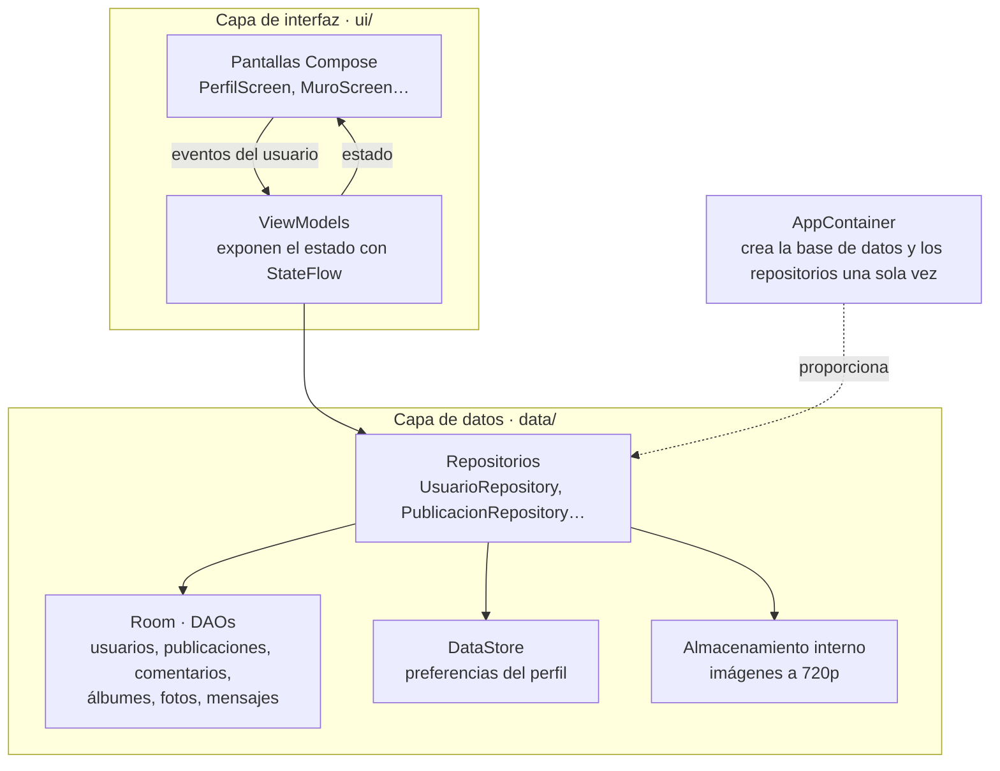

# Arquitectura y decisiones técnicas

Decisiones iniciales de arquitectura y tecnologías de Retroconver, listas para la memoria v2 (E2-07, [#48](https://github.com/yeray06/Retroconver/issues/48)). El código base que las aplica está en las tareas E2-01 a E2-03.

## 1. Patrón: MVVM con repositorios

La app sigue el patrón **MVVM** (*Model-View-ViewModel*) que recomienda Google para Android, con una capa de **repositorios** entre los ViewModels y los datos.



| Capa | Qué hace | Qué no hace |
|---|---|---|
| **Pantallas (Compose)** | Dibujan el estado que reciben y avisan al ViewModel de lo que hace la persona usuaria | No acceden a la base de datos ni guardan estado propio, salvo el estado puramente visual |
| **ViewModels** | Guardan el estado de cada pantalla en un `StateFlow`, validan formularios y llaman a los repositorios | No conocen Compose ni el `Context` |
| **Repositorios** | Son la única puerta a los datos. Combinan Room, DataStore y los ficheros de imagen | No contienen lógica de pantalla |
| **Room / DataStore / ficheros** | Guardan la información en el dispositivo | — |

**Flujo de datos en un solo sentido:** el estado baja de los repositorios al ViewModel y a la pantalla, y los eventos suben de la pantalla al ViewModel. Room y DataStore devuelven `Flow`, así que cuando cambia un dato la pantalla se actualiza sola. Por ejemplo, al publicar algo aparece arriba del muro sin recargar nada.

## 2. Estructura del código

```
app/src/main/java/com/retroconver/
├── RetroconverApp.kt          Application: crea el AppContainer
├── MainActivity.kt            Única Activity: aplica el tema y la navegación
├── AppContainer.kt            Base de datos y repositorios (una sola instancia)
├── data/
│   ├── local/                 AppDatabase, entidades, DAOs y convertidores
│   └── repository/            Repositorios de cada módulo
├── navigation/                Rutas y barra de navegación inferior
└── ui/
    ├── theme/                 Colores, tipografías y formas retro
    ├── components/            RetroCard, RetroButton, RetroHeader, Avatar…
    └── screens/
        ├── perfil/            Yeray
        ├── galeria/           Yeray
        ├── muro/              David
        └── mensajes/          David
```

Cada integrante trabaja en las carpetas de sus módulos, así casi nunca tocamos el mismo fichero. Los ficheros compartidos son `AppDatabase`, `AppContainer`, la navegación, el tema y el catálogo de versiones. En esos hacemos cambios pequeños y nos avisamos.

## 3. Tecnologías y por qué

| Tecnología | Para qué | Por qué esta y no otra |
|---|---|---|
| **Kotlin** | Todo el código | Lenguaje oficial de Android. Corrutinas y `Flow` para el trabajo en segundo plano |
| **Jetpack Compose** | Interfaz | Interfaz declarativa: menos código que con XML y vistas previas de cada componente. El tema retro se define una vez y se aplica a todas las pantallas |
| **Navigation Compose** | Navegación | Una sola Activity con la barra inferior y la pila de pantallas. Más sencillo que usar una Activity por sección |
| **Room** | Usuarios, publicaciones, comentarios, álbumes, fotos y mensajes | Datos con relaciones: una publicación tiene comentarios y un álbum tiene fotos. Room comprueba las consultas SQL al compilar y devuelve `Flow`, al contrario que SQLite a mano |
| **DataStore (Preferences)** | Color de fondo, tema y ajustes del perfil | Son pares clave-valor sin relaciones. Al contrario que `SharedPreferences`, no bloquea el hilo principal y avisa de los cambios con `Flow` |
| **Photo Picker** (`PickVisualMedia`) | Elegir fotos del dispositivo | En Android 13 o superior no necesita ningún permiso, y en versiones anteriores se usa la versión compatible. Así se cumple «permisos solo cuando hacen falta» |
| **Almacenamiento interno** (`filesDir/images`) | Copia de cada imagen reescalada a 720p | La foto sigue en la app aunque la persona usuaria la borre de su galería. En Room solo se guarda la ruta, no la imagen |
| **Coil** | Mostrar imágenes desde fichero | Carga las imágenes en segundo plano y las guarda en caché. Hacerlo a mano con `BitmapFactory` es más código y más fácil de hacer mal |
| **KSP** | Generar el código de Room | Sustituye a `kapt`, que está obsoleto con Kotlin 2, y compila más rápido |
| **Inyección de dependencias manual** (`AppContainer`) | Dar a cada ViewModel sus repositorios | Somos dos y la app tiene pocas dependencias. Hilt añadiría anotaciones y configuración que no necesitamos |

## 4. Qué guarda cada sistema de almacenamiento

| Dato | Dónde | Motivo |
|---|---|---|
| Usuario (nombre, biografía, estado, ruta del avatar) | Room | Es una entidad relacionada con publicaciones y mensajes |
| Publicaciones y comentarios | Room | Relación uno a muchos, con orden por fecha |
| Álbumes y fotos (ruta y fecha) | Room | Relación uno a muchos |
| Mensajes del tablón | Room | Relación con el usuario autor y el perfil de destino |
| Color de fondo y tema del perfil | DataStore | Preferencias simples sin relaciones |
| Imágenes | Ficheros en `filesDir/images` | Las bases de datos no son buenas guardando imágenes. Room guarda solo la ruta |

El diagrama entidad-relación completo es la tarea E2-05.1 ([#44](https://github.com/yeray06/Retroconver/issues/44)).

## 5. Versiones de Android

| Ajuste | Valor | Motivo |
|---|---|---|
| `minSdk` | **26** (Android 8.0) | Desde esta versión `java.time` está incluido en Android, así que las fechas de publicaciones, comentarios y mensajes se manejan sin librerías extra. Cubre la gran mayoría de móviles en uso, según el asistente de Android Studio |
| `targetSdk` y `compileSdk` | **36** (Android 16) | La última versión estable. Con ella probamos el comportamiento actual de permisos y del Photo Picker |

## 6. Cómo se conecta un ViewModel con sus datos

Cada ViewModel recibe sus repositorios desde el `AppContainer` con una *factory*. Así se crea, por ejemplo, el ViewModel del muro (E2-03.2, [#39](https://github.com/yeray06/Retroconver/issues/39)):

```kotlin
class MuroViewModel(private val repo: PublicacionRepository) : ViewModel() {
    val publicaciones = repo.publicaciones()
        .stateIn(viewModelScope, SharingStarted.WhileSubscribed(5_000), emptyList())

    companion object {
        val Factory = viewModelFactory {
            initializer {
                val app = this[APPLICATION_KEY] as RetroconverApp
                MuroViewModel(app.container.publicacionRepository)
            }
        }
    }
}

// En la pantalla:
@Composable
fun MuroScreen(viewModel: MuroViewModel = viewModel(factory = MuroViewModel.Factory)) {
    val publicaciones by viewModel.publicaciones.collectAsStateWithLifecycle()
    // …
}
```

## 7. Pruebas

| Qué | Cómo |
|---|---|
| Reescalado a 720p | Pruebas unitarias con imágenes de distintos tamaños y orientaciones |
| DAOs de Room | Pruebas con una base de datos en memoria: inserción, orden por fecha y borrado en cascada |
| Accesibilidad | Revisión con TalkBack y el Accessibility Scanner |
