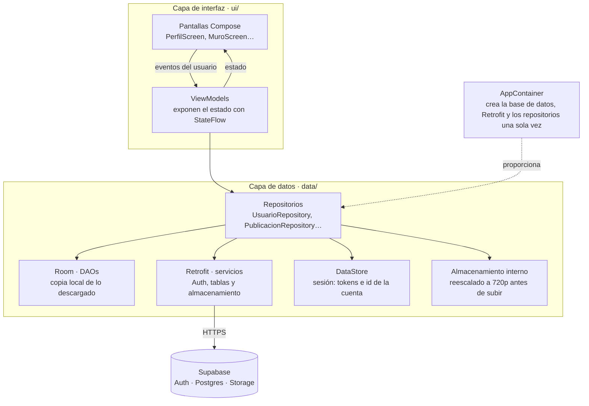
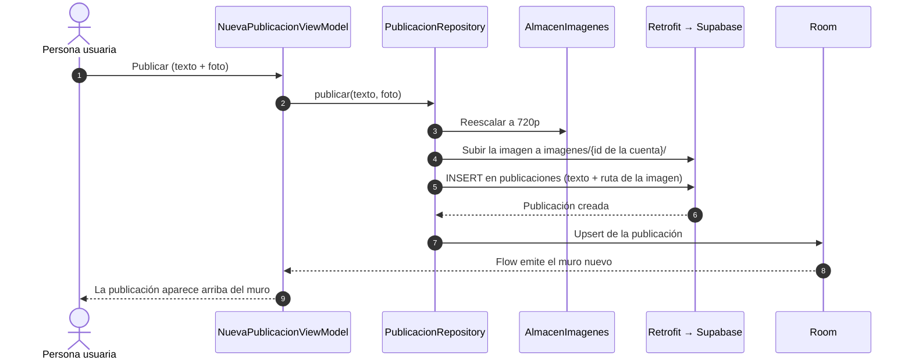

# Arquitectura y decisiones técnicas

Arquitectura de Retroconver y por qué se eligió cada tecnología. La primera versión (memoria v2, E2-07) guardaba todo en el móvil. Desde la entrega 4 la app es una red social con servidor (E4-01, [#109](https://github.com/yeray06/Retroconver/issues/109)): este documento describe la arquitectura con servidor.

## 1. Patrón: MVVM con repositorios

La app sigue el patrón **MVVM** (*Model-View-ViewModel*) que recomienda Google para Android, con una capa de **repositorios** entre los ViewModels y los datos.



| Capa | Qué hace | Qué no hace |
|---|---|---|
| **Pantallas (Compose)** | Dibujan el estado que reciben y avisan al ViewModel de lo que hace la persona usuaria | No acceden a la base de datos ni a la red |
| **ViewModels** | Guardan el estado de cada pantalla en un `StateFlow`, validan formularios y llaman a los repositorios | No conocen Compose, el `Context` ni Retrofit |
| **Repositorios** | Son la única puerta a los datos. Hablan con el servidor, guardan la copia en Room y combinan los dos | No contienen lógica de pantalla |
| **Room / Retrofit / DataStore / ficheros** | Guardan o traen la información | — |

**Flujo de datos en un solo sentido:** el estado baja de los repositorios al ViewModel y a la pantalla, y los eventos suben de la pantalla al ViewModel. Gracias a esta separación, pasar a servidor solo cambia la capa de datos: las pantallas de la entrega 3 se reutilizan.

## 2. El servidor es la fuente de verdad y Room guarda una copia

Las pantallas **siempre leen de Room**, que devuelve `Flow`. El servidor es quien tiene los datos de verdad, y los repositorios mantienen Room al día:

- **Leer.** Al abrir una pantalla o deslizar para actualizar, el repositorio descarga del servidor y guarda en Room con `@Upsert`. Room avisa del cambio y la pantalla se actualiza sola. Sin conexión no se descarga nada, pero la pantalla sigue mostrando la última copia (RNF-06).
- **Escribir.** Publicar, comentar o editar el perfil se envía primero al servidor. Si responde bien, se guarda su respuesta en Room. Sin conexión no se guarda nada y la pantalla avisa. No hay cola de envíos pendientes, que complicaría mucho la app.



### Cómo pasa un módulo al servidor (patrón E4-05)

El perfil fue el primer módulo en pasar a servidor (E4-05, [#120](https://github.com/yeray06/Retroconver/issues/120)). Los demás (muro, comentarios, tablón, galería) siguen los mismos pasos. Como ejemplo, `UsuarioRepository`:

1. **DTO y servicio** en `data/remote/`. El DTO tiene los nombres de las columnas del servidor (`@SerialName("avatar_ruta")`) y el servicio las llamadas de Retrofit a su tabla (`PerfilService`).
2. **Conversión a la entidad de Room** en `data/repository/Conversiones.kt`, por ejemplo `PerfilDto.aEntidad()`. Las fechas se leen con `instanteDelServidor()` y las rutas de imagen se convierten en URL pública con `configuracion.urlPublica(ruta)`.
3. **Ids `String` (UUID)** y **`@Upsert`** en el DAO: lo que llega del servidor se crea o se actualiza sin duplicarse y sin borrar en cascada a los hijos.
4. **Leer:** las pantallas observan Room. El repositorio tiene un `refrescar()` que descarga y guarda:
   ```kotlin
   suspend fun refrescar(id: String): ResultadoRed<Unit> =
       llamarAlServidor { perfilService.obtener(igual(id)) }
           .map { filas -> filas.firstOrNull()?.let { usuarioDao.guardar(it.aEntidad(configuracion)) }; Unit }
   ```
5. **Escribir:** primero el servidor, con `Prefer: return=representation`, y después **la fila que devuelve** en Room. Si no hay red no se guarda nada y la pantalla conserva lo escrito.
6. **Imágenes:** se reescalan a 720p con `AlmacenImagenes`, se suben a `imagenes/{id de la cuenta}/{uuid}.jpg` y la tabla guarda la ruta. Al cambiar o borrar, se borra la imagen anterior del servidor. Si falla el `INSERT`/`PATCH` después de subir, se borra la recién subida para no dejarla suelta. Las fotos de la galería se suben en segundo plano con WorkManager (`data/subidas/`, [#147](https://github.com/yeray06/Retroconver/issues/147)), así la subida sigue aunque se salga de la pantalla o se cierre la app.
7. **Autores que vienen dentro de otra respuesta** (`select=*,autor:perfiles(*)`): se guardan con `usuarioRepository.guardarDelServidor(perfiles)`. Así el nombre y el avatar nuevos de cada persona se ven en sus publicaciones al refrescar.
8. **ViewModel:** cada llamada devuelve `ResultadoRed`. En `Correcto` no hace falta tocar el estado, porque Room avisa solo. En `Fallo` se guarda `fallo.mensaje()` (el id del texto) y la pantalla lo muestra con `stringResource`.
   ```kotlin
   when (val respuesta = usuarios.actualizarPerfil(nombre, biografia, estado)) {
       is ResultadoRed.Correcto -> guardado = true
       is ResultadoRed.Fallo -> errorGuardar = respuesta.mensaje()
   }
   ```

## 3. Estructura del código

```
app/src/main/java/com/retroconver/
├── RetroconverApp.kt          Application: crea el AppContainer
├── MainActivity.kt            Única Activity: aplica el tema y la navegación
├── AppContainer.kt            Base de datos, Retrofit y repositorios (una sola instancia)
├── data/
│   ├── local/                 AppDatabase, entidades, DAOs y convertidores (copia local)
│   ├── remote/                Servicios de Retrofit y DTOs del servidor
│   ├── sesion/                Sesión con DataStore
│   ├── imagenes/              Reescalado a 720p
│   └── repository/            Repositorios de cada módulo
├── navigation/                Rutas y barra de navegación inferior
└── ui/
    ├── theme/                 Colores, tipografías y formas retro
    ├── components/            RetroCard, RetroButton, RetroHeader, Avatar…
    └── screens/
        ├── acceso/            Inicio de sesión y registro (Yeray)
        ├── perfil/            Yeray (perfiles ajenos: David)
        ├── galeria/           Yeray
        ├── muro/              David
        └── mensajes/          David
supabase/
└── esquema.sql                Tablas, seguridad y almacenamiento del servidor
```

Cada integrante trabaja en las carpetas de sus módulos, así casi nunca tocamos el mismo fichero. Los ficheros compartidos son `AppDatabase`, `AppContainer`, la navegación, el tema, el catálogo de versiones y `supabase/esquema.sql`. En esos hacemos cambios pequeños y nos avisamos.

## 4. Tecnologías y por qué

| Tecnología | Para qué | Por qué esta y no otra |
|---|---|---|
| **Kotlin** | Todo el código | Lenguaje oficial de Android. Corrutinas y `Flow` para el trabajo en segundo plano |
| **Jetpack Compose** | Interfaz | Interfaz declarativa: menos código que con XML y vistas previas de cada componente. El tema retro se define una vez y se aplica a todas las pantallas |
| **Navigation Compose** | Navegación | Una sola Activity con la barra inferior y la pila de pantallas |
| **Supabase** | Servidor: cuentas (Auth), base de datos (Postgres) y almacenamiento de imágenes (Storage) | El plan gratuito incluye las tres cosas sin tarjeta, también las imágenes. Firebase exige el plan de pago para guardar imágenes. Además, Supabase es SQL con claves foráneas, como Room, y las reglas de seguridad se escriben en SQL |
| **Retrofit + OkHttp** | Hablar con Supabase por HTTPS | Supabase expone una API REST para Auth (`/auth/v1`), las tablas (`/rest/v1`) y el almacenamiento (`/storage/v1`). Retrofit convierte cada llamada en una función `suspend`, y OkHttp añade la clave y el token a todas las peticiones y renueva el token cuando caduca |
| **kotlinx.serialization** | Convertir el JSON del servidor en clases de Kotlin | Es la librería de Kotlin, sin reflexión, y Retrofit tiene conversor oficial |
| **Room** | Copia local de perfiles, publicaciones, comentarios, álbumes, fotos y mensajes | Las pantallas leen de Room, que devuelve `Flow`: se actualizan solas al llegar datos nuevos y funcionan sin conexión. Room comprueba las consultas SQL al compilar |
| **DataStore (Preferences)** | Sesión: token de acceso, token de renovación e id de la cuenta | Son unos pocos valores sin relaciones que hay que leer al arrancar. Al contrario que `SharedPreferences`, no bloquea el hilo principal y avisa de los cambios con `Flow`, así la app vuelve al login sola cuando se cierra la sesión |
| **Photo Picker** (`PickVisualMedia`) | Elegir fotos del dispositivo | No necesita permisos en ninguna versión de Android |
| **Almacenamiento interno** (`filesDir/images`) | Copia reescalada a 720p antes de subirla | Se sube la versión reducida, así el servidor no se llena y las fotos cargan rápido |
| **Coil** (con `coil-network-okhttp`) | Mostrar las imágenes del servidor y de fichero | Carga las imágenes en segundo plano y las guarda en caché en disco, así se ven sin conexión si ya se habían visto |
| **KSP** | Generar el código de Room | Sustituye a `kapt`, que está obsoleto con Kotlin 2, y compila más rápido |
| **Inyección de dependencias manual** (`AppContainer`) | Dar a cada ViewModel sus repositorios | Somos dos y la app tiene pocas dependencias. Hilt añadiría anotaciones y configuración que no necesitamos |

### Llamadas al servidor

| Para qué | Llamada |
|---|---|
| Registrarse | `POST /auth/v1/signup` con email, contraseña y nombre |
| Iniciar sesión | `POST /auth/v1/token?grant_type=password` |
| Renovar la sesión | `POST /auth/v1/token?grant_type=refresh_token` |
| Cerrar sesión | `POST /auth/v1/logout` |
| Leer el muro | `GET /rest/v1/publicaciones?select=*,autor:perfiles(*)&order=creada_en.desc&limit=50` |
| Publicar, comentar, escribir en un tablón | `POST /rest/v1/{tabla}` |
| Subir una imagen | `POST /storage/v1/object/imagenes/{id de la cuenta}/{uuid}.jpg` |
| Ver una imagen | `GET /storage/v1/object/public/imagenes/{ruta}` (la carga Coil) |

### Errores de red y funcionamiento sin conexión

Ninguna excepción de red llega a las pantallas (E4-03.2, [#115](https://github.com/yeray06/Retroconver/issues/115)). Cada llamada pasa por `llamarAlServidor { … }`, que devuelve un `ResultadoRed`:

| Caso | Cuándo | Qué hace la pantalla |
|---|---|---|
| `Correcto(datos)` | El servidor responde bien | El repositorio guarda los datos en Room y la pantalla se actualiza sola |
| `SinConexion` | No hay red, el servidor no contesta o se agota el tiempo | Sigue mostrando la copia de Room y avisa de que no se ha podido guardar |
| `SesionCaducada` | El token no vale y no se ha podido renovar | Vuelve al inicio de sesión |
| `ErrorServidor(estado, código)` | El servidor rechaza la petición: email ya registrado, texto vacío, sin permiso… | Muestra el motivo |

`fallo.mensaje()` (`data/remote/MensajesRed.kt`) traduce cada caso a un texto en español de `strings_red.xml`, también los códigos de Supabase más habituales (`user_already_exists`, `invalid_credentials`, `23514`…).

Además, mientras el móvil no tiene red se muestra una franja amarilla bajo la cabecera: *«Sin conexión. Ves lo último guardado; no puedes publicar ni comentar hasta que vuelva la red»* (`MonitorConexion` y `AvisoSinConexion`).

## 5. Qué guarda cada sistema

| Dato | Dónde | Motivo |
|---|---|---|
| Cuentas (email y contraseña) | **Supabase Auth** | La contraseña nunca se guarda en el móvil ni en nuestras tablas |
| Perfiles, publicaciones, comentarios, álbumes, fotos y mensajes | **Supabase (Postgres)** | Se comparten entre todas las personas. Relaciones con claves foráneas y borrado en cascada |
| Imágenes (avatar, publicaciones y galería) | **Supabase Storage**, bucket `imagenes` | Las bases de datos no son buenas guardando imágenes: la tabla guarda solo la ruta |
| Copia de lo descargado | **Room** | Para que las pantallas se actualicen solas y funcionen sin conexión |
| Sesión (tokens e id de la cuenta) | **DataStore** | Valores sueltos que se leen al arrancar |
| Imagen reducida antes de subirla | `filesDir/images` | Se reescala a 720p y se sube esa copia |

El esquema de las tablas del servidor está en [docs/datos/esquemadatos.md](datos/esquemadatos.md) y el SQL en `supabase/esquema.sql` (E4-02.1, [#111](https://github.com/yeray06/Retroconver/issues/111)).

## 6. Seguridad

- **Políticas de seguridad (RLS).** La clave pública de Supabase (*anon key*) viaja dentro de la app, así que cualquiera podría usarla fuera de ella. Por eso cada tabla tiene políticas en el servidor: con sesión se puede leer todo, pero solo se crea, cambia o borra lo propio. El dueño de un tablón puede borrar cualquier mensaje de su tablón (E4-02.2, [#112](https://github.com/yeray06/Retroconver/issues/112)).
- **Imágenes.** Cada cuenta solo puede subir y borrar archivos de su carpeta (`imagenes/{id de la cuenta}/`). El bucket es de lectura pública para que Coil cargue las imágenes por URL sin token. Las rutas llevan un UUID y no se pueden adivinar, pero quien tenga la URL exacta puede ver la imagen. Para un proyecto de clase es un buen equilibrio; la alternativa serían URLs firmadas que caducan.
- **Claves fuera del repositorio.** La URL y la clave pública van en `local.properties`, que Git ignora, y llegan al código por `BuildConfig` (E4-03.1, [#114](https://github.com/yeray06/Retroconver/issues/114)).
- **Sesión.** El móvil guarda el token de acceso y el de renovación, nunca la contraseña. El token de acceso caduca en una hora y se renueva solo (E4-04.1, [#117](https://github.com/yeray06/Retroconver/issues/117)):
  - Antes de cada petición, si le queda menos de un minuto, `SesionRepository` lo renueva.
  - Si aun así el servidor responde 401, `RenovadorDeSesion` (un `Authenticator` de OkHttp) lo renueva y repite la petición una vez.
  - Si el servidor ya no acepta el token de renovación, la sesión se cierra, se borra la copia local y la app vuelve al inicio de sesión. Sin red no se cierra nada: se vuelve a intentar más tarde.
  - Las llamadas de Auth van en un cliente HTTP aparte, sin el token de la sesión, para que renovar no dependa del token caducado.
- **Cerrar sesión** borra los tokens, la base de datos Room y las imágenes guardadas en el móvil (E4-04.3, [#119](https://github.com/yeray06/Retroconver/issues/119)).

## 7. Versiones de Android

| Ajuste | Valor | Motivo |
|---|---|---|
| `minSdk` | **26** (Android 8.0) | Desde esta versión `java.time` está incluido en Android, así que las fechas se manejan sin librerías extra. Cubre la gran mayoría de móviles en uso |
| `targetSdk` y `compileSdk` | **36** (Android 16) | La última versión estable. Con ella probamos el comportamiento actual de permisos y del Photo Picker |

## 8. Cómo se conecta un ViewModel con sus datos

Cada ViewModel recibe sus repositorios desde el `AppContainer` con una *factory*. Así se crea, por ejemplo, el ViewModel del muro (E2-03.2, [#39](https://github.com/yeray06/Retroconver/issues/39)):

```kotlin
class MuroViewModel(private val repo: PublicacionRepository) : ViewModel() {
    // La pantalla lee de Room…
    val publicaciones = repo.publicaciones()
        .stateIn(viewModelScope, SharingStarted.WhileSubscribed(5_000), emptyList())

    // …y el repositorio la mantiene al día con el servidor
    fun actualizar() = viewModelScope.launch { repo.refrescar() }

    companion object {
        val Factory = viewModelFactory {
            initializer {
                val app = this[APPLICATION_KEY] as RetroconverApp
                MuroViewModel(app.container.publicacionRepository)
            }
        }
    }
}
```

## 9. Pruebas

| Qué | Cómo |
|---|---|
| Reescalado a 720p y validaciones | Pruebas unitarias con distintos tamaños, orientaciones y textos |
| DAOs de Room | Pruebas con una base de datos en memoria: inserción, orden por fecha y borrado en cascada |
| Sesión y cliente de red | Pruebas con **MockWebServer**, un servidor falso que devuelve respuestas preparadas: correctas, errores y token caducado |
| Políticas de seguridad | Pruebas manuales con dos cuentas: una no puede borrar ni cambiar lo de la otra |
| Accesibilidad | Comprobaciones automáticas del Accessibility Test Framework en cada pantalla, y revisión con TalkBack y el Accessibility Scanner |

La lista completa de pruebas y su resultado está en [docs/pruebas.md](pruebas.md).
