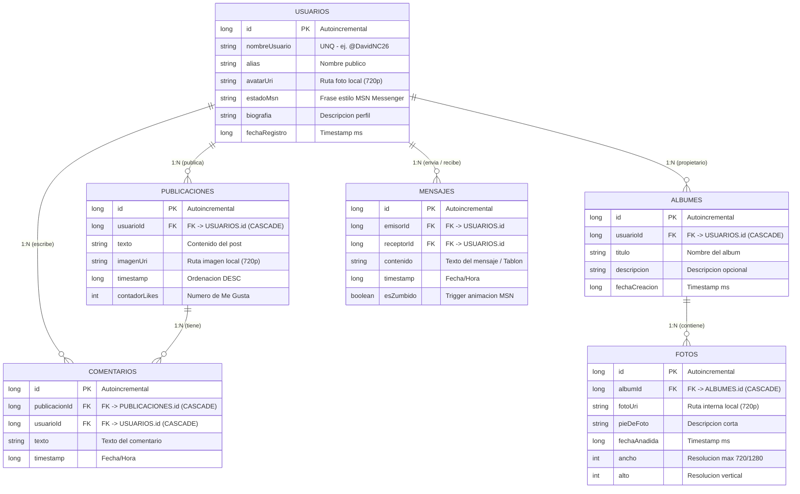

# Modelo de Datos Local y Estrategia de Persistencia — Retroconver

**Responsable:** @DavidNC26  
**Tarea Principal:** #11 (E2-05) — Subtareas #44 y #45  
**Proyecto:** Retroconver (Android Native / Jetpack Compose)  
**Ubicación:** `docs/diseno/esquema_datos.md` / Memoria v2  

---

## 1. Diagrama Entidad-Relación (Room Database)

El siguiente diagrama Mermaid define las 6 entidades del sistema, sus campos, tipos de datos en Kotlin/Room, claves primarias (`PK`) y claves foráneas (`FK`):

---

## 2. Definición de Claves y Relaciones

### 2.1 Claves Primarias (`PrimaryKey`)
Todas las entidades utilizan una clave primaria de tipo `Long` autoincremental (`autoGenerate = true`):
* `USUARIOS.id`
* `PUBLICACIONES.id`
* `COMENTARIOS.id`
* `ALBUMES.id`
* `FOTOS.id`
* `MENSAJES.id`

### 2.2 Claves Foráneas (`ForeignKey`) e Integridad Referencial
1. **`PUBLICACIONES.usuarioId`** $\rightarrow$ `USUARIOS.id` (`onDelete = CASCADE`). Al eliminar un usuario se borran sus publicaciones.
2. **`COMENTARIOS.publicacionId`** $\rightarrow$ `PUBLICACIONES.id` (`onDelete = CASCADE`). Al eliminar un post se borran sus comentarios.
3. **`COMENTARIOS.usuarioId`** $\rightarrow$ `USUARIOS.id` (`onDelete = CASCADE`).
4. **`ALBUMES.usuarioId`** $\rightarrow$ `USUARIOS.id` (`onDelete = CASCADE`).
5. **`FOTOS.albumId`** $\rightarrow$ `ALBUMES.id` (`onDelete = CASCADE`). Al eliminar un álbum se borran sus fotos asociadas.
6. **`MENSAJES.emisorId`** y **`MENSAJES.receptorId`** $\rightarrow$ `USUARIOS.id`. Doble relación para conversaciones y mensajes del tablón.

---

## 3. Justificación Técnica: Room vs DataStore

| Tipo de Dato / Requisito | Tecnología Elegida | Justificación Técnica |
| :--- | :--- | :--- |
| **Entidades Relacionales (Posts, Comentarios, Álbumes, Fotos, Mensajes)** | **Room (SQLite)** | Datos con estructura relacional 1:N que requieren consultas complejas (`ORDER BY timestamp DESC`), claves foráneas con borrado en cascada (`CASCADE`) y reactividad mediante `Flow`. |
| **Metadatos de Usuario (ID, Alias, Avatar)** | **Room (SQLite)** | Al actuar como clave foránea en publicaciones y comentarios, debe residir en la base de datos relacional. |
| **Tema Retro Global (Azul Glossy, Tema Oscuro)** | **DataStore Preferences** | Ajustes clave-valor ligeros. Se leen asíncronamente al iniciar la app para aplicar el tema de Compose sin sobrecargar la base de datos. |
| **Color de Fondo del Perfil** | **DataStore Preferences** | Preferencia de UI simple sin relaciones con otras entidades. |
| **Filtro activo del Muro (Ver todo / Solo fotos)** | **DataStore Preferences** | Mantiene el estado de la UI seleccionado por el usuario entre sesiones. |
| **Archivos de Imagen a 720p** | **Almacenamiento Interno + Room** | Las imágenes físicas no se guardan como BLOB en la base de datos (para no saturar `CursorWindow`). Se procesan a 720p, se guardan en el almacenamiento interno privado y Room almacena únicamente la ruta/URI (`String`). |

---

## 4. Control de Revisión del Equipo

- [x] **Diseñado por:** @DavidNC26
- [ ] **Revisado y aprobado por:** @yeray06 (Pendiente antes de la creación de DAOs en `#38`)