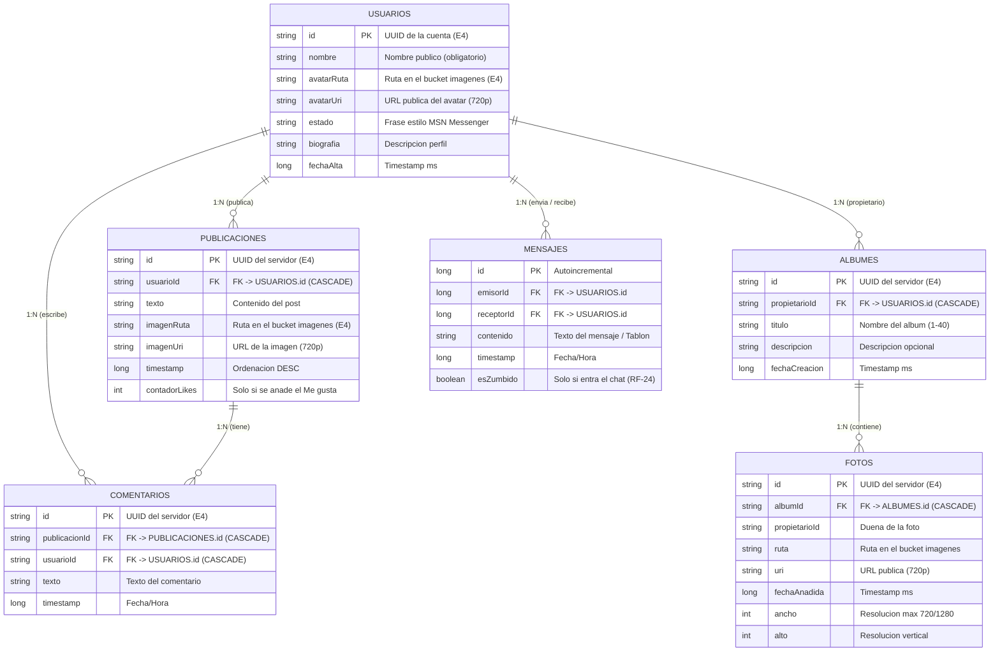
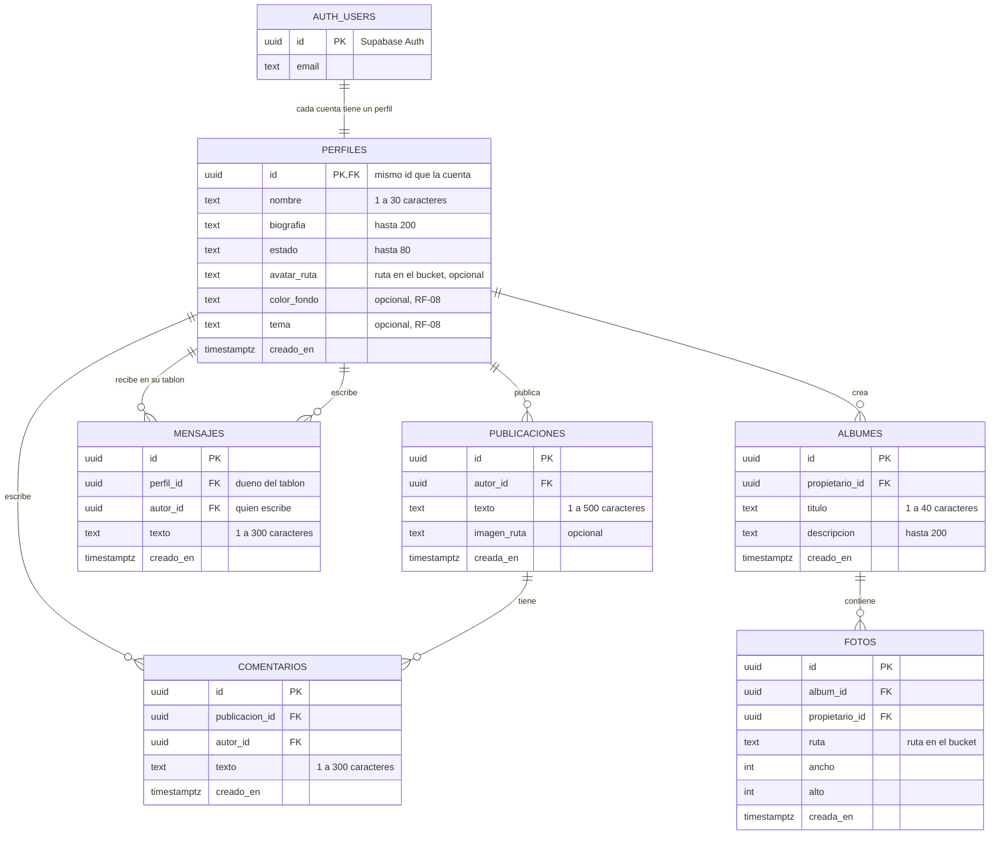

# Modelo de Datos Local y Estrategia de Persistencia — Retroconver

**Responsable:** @DavidNC26  
**Tarea Principal:** #11 (E2-05) — Subtareas #44 y #45  
**Proyecto:** Retroconver (Android Native / Jetpack Compose)  
**Ubicación:** `docs/datos/esquemadatos.md` / Memoria v2  

> **Entrega 4:** los datos pasan a un servidor Supabase y Room queda como copia local. Las secciones 1 a 4 describen el modelo de la entrega 2; el modelo del servidor está en la [sección 5](#5-servidor-supabase-entrega-4).

---

## 1. Diagrama Entidad-Relación (Room Database)

El siguiente diagrama Mermaid define las 6 entidades del sistema, sus campos, tipos de datos en Kotlin/Room, claves primarias (`PK`) y claves foráneas (`FK`):

---

## 2. Definición de Claves y Relaciones

### 2.1 Claves Primarias (`PrimaryKey`)
> **Desde la entrega 4** (E4-05.1, [#121](https://github.com/yeray06/Retroconver/issues/121)) las claves son `String` con el **UUID que pone el servidor**, no `Long` autoincrementales: así la copia de Room usa los mismos ids que Supabase y lo descargado se guarda con `@Upsert` sin duplicar. Ya están `USUARIOS`, `PUBLICACIONES` y `COMENTARIOS` (versión 4) y `ALBUMES` y `FOTOS` (versión 5, E4-10.1, [#68](https://github.com/yeray06/Retroconver/issues/68)); `MENSAJES` nace así en E4-09. El pie de foto del boceto no se ha hecho: no está en los requisitos. Ver el apartado 5.4.

En la primera versión, todas las entidades usaban una clave primaria de tipo `Long` autoincremental (`autoGenerate = true`):
* `USUARIOS.id`
* `PUBLICACIONES.id`
* `COMENTARIOS.id`
* `ALBUMES.id`
* `FOTOS.id`
* `MENSAJES.id`

### 2.2 Claves Foráneas (`ForeignKey`) e Integridad Referencial
1. **`PUBLICACIONES.usuarioId`** $\rightarrow$ `USUARIOS.id` (`onDelete = CASCADE`). Al eliminar un usuario se borran sus publicaciones.
2. **`COMENTARIOS.publicacionId`** $\rightarrow$ `PUBLICACIONES.id` (`onDelete = CASCADE`). Al eliminar un post se borran sus comentarios.
3. **`COMENTARIOS.usuarioId`** $\rightarrow$ `USUARIOS.id` (`onDelete = CASCADE`).
4. **`ALBUMES.usuarioId`** $\rightarrow$ `USUARIOS.id` (`onDelete = CASCADE`).
5. **`FOTOS.albumId`** $\rightarrow$ `ALBUMES.id` (`onDelete = CASCADE`). Al eliminar un álbum se borran sus fotos asociadas.
6. **`MENSAJES.emisorId`** y **`MENSAJES.receptorId`** $\rightarrow$ `USUARIOS.id`. Doble relación para conversaciones y mensajes del tablón.

---

## 3. Justificación Técnica: Room vs DataStore

| Tipo de Dato / Requisito | Tecnología Elegida | Justificación Técnica |
| :--- | :--- | :--- |
| **Entidades Relacionales (Posts, Comentarios, Álbumes, Fotos, Mensajes)** | **Room (SQLite)** | Datos con estructura relacional 1:N que requieren consultas complejas (`ORDER BY timestamp DESC`), claves foráneas con borrado en cascada (`CASCADE`) y reactividad mediante `Flow`. |
| **Metadatos de Usuario (ID, Nombre, Avatar)** | **Room (SQLite)** | Al actuar como clave foránea en publicaciones y comentarios, debe residir en la base de datos relacional. |
| **Tema elegido para el perfil (RF-08)** | **DataStore Preferences** | Ajustes clave-valor ligeros. Se leen asíncronamente al iniciar la app para aplicar el tema del perfil sin sobrecargar la base de datos. |
| **Color de Fondo del Perfil** | **DataStore Preferences** | Preferencia de UI simple sin relaciones con otras entidades. |
| **Filtro activo del Muro (Ver todo / Solo fotos), si se añade** | **DataStore Preferences** | Mantiene el estado de la UI seleccionado por el usuario entre sesiones. |
| **Archivos de Imagen a 720p** | **Almacenamiento Interno + Room** | Las imágenes físicas no se guardan como BLOB en la base de datos (para no saturar `CursorWindow`). Se procesan a 720p, se guardan en el almacenamiento interno privado y Room almacena únicamente la ruta/URI (`String`). |

---

## 4. Control de Revisión del Equipo

- [x] **Diseñado por:** @DavidNC26
- [x] **Revisado por:** @yeray06 (30/10/2026), antes de crear la primera entidad con DAO en E3-01 ([#13](https://github.com/yeray06/Retroconver/issues/13))

### Cambios de la revisión

1. **USUARIOS** usa `nombre` y `fechaAlta`, los mismos nombres que la entidad mínima que ya está en el código (`UsuarioEntity`, E2-03). Se quita `nombreUsuario` único porque no hay cuentas ni inicio de sesión (RF-04): el usuario local se crea solo al abrir la app.
2. **`PUBLICACIONES.contadorLikes`** y **`MENSAJES.esZumbido`** dependen de los [puntos a decidir](../requisitos.md#puntos-a-decidir-entre-los-dos). Si no se añade el «Me gusta» o el chat privado, esas columnas no se crean.
3. El número de comentarios de cada publicación (RF-14) y el número de fotos y la portada de cada álbum (RF-18) no se guardan en columnas: se calculan con una consulta (`COUNT`, primera foto del álbum), así no se desincronizan.
4. Se corrige la ubicación del documento y la issue de los DAOs (`#38` es E2-03.1, la base de datos).

---

## 5. Servidor Supabase (entrega 4)

Desde la entrega 4 (E4-01, [#109](https://github.com/yeray06/Retroconver/issues/109)) los datos se guardan en un proyecto Supabase con el plan gratuito. El SQL que crea todo está en `supabase/esquema.sql` (E4-02.1, [#111](https://github.com/yeray06/Retroconver/issues/111)).

### 5.1 Tablas

Mismas entidades que en Room, con dos cambios: las claves son **UUID**, para que no choquen las que crean distintos móviles, y los nombres de columna van en `snake_case`, como es costumbre en Postgres. La tabla `usuarios` pasa a llamarse `perfiles`, porque la cuenta (email y contraseña) la guarda Supabase Auth en `auth.users`.

- **Borrado en cascada** en todas las claves foráneas: si se borra una cuenta se borra su perfil y todo lo suyo; si se borra una publicación, sus comentarios; si se borra un álbum, sus fotos.
- **Límites de texto con `CHECK`**, los mismos que valida la app. Así no se guardan datos fuera de límite aunque alguien llame al servidor sin pasar por la app.
- **Perfil automático.** Un *trigger* sobre `auth.users` crea la fila de `perfiles` al registrarse, con el nombre que se escribió en el formulario de registro.
- **Contadores calculados.** El número de comentarios de una publicación y el de fotos de un álbum se calculan en la consulta, no se guardan.
- `contadorLikes` y `esZumbido` del diagrama de la entrega 2 no se crean: son los extras EX-05 y EX-01.

### 5.2 Imágenes

Bucket `imagenes` de Supabase Storage, con un límite de 2 MB por archivo y solo JPEG y PNG. Cada cuenta tiene su carpeta (`imagenes/{id de la cuenta}/{uuid}.jpg`) y las tablas guardan solo la ruta. Antes de subir, la app reduce la imagen a 720p (RNF-02).

### 5.3 Seguridad (RLS)

Todas las tablas tienen activadas las políticas de seguridad de Postgres (*Row Level Security*, E4-02.2, [#112](https://github.com/yeray06/Retroconver/issues/112)):

| Tabla | Leer | Crear | Cambiar | Borrar |
|---|---|---|---|---|
| `perfiles` | Con sesión | Solo el *trigger* al registrarse | Solo el propio | Al borrar la cuenta |
| `publicaciones` | Con sesión | Como autor | Solo el autor | Solo el autor |
| `comentarios` | Con sesión | Como autor | Solo el autor | Solo el autor |
| `mensajes` | Con sesión | Como autor, en cualquier tablón | — | El autor o el dueño del tablón |
| `albumes` y `fotos` | Con sesión | Como propietario | Solo el propietario | Solo el propietario |
| Bucket `imagenes` | Cualquiera con la URL | En la carpeta propia | En la carpeta propia | En la carpeta propia |

### 5.4 Qué cambia en Room

Room deja de ser la fuente de verdad y pasa a guardar **una copia de lo descargado** (E4-05, [#120](https://github.com/yeray06/Retroconver/issues/120)). Las entidades usan los mismos ids UUID (`String`) y los DAOs guardan con `@Upsert`. El usuario local fijo de la entrega 3 desaparece: el usuario actual es el de la sesión, que guarda DataStore. La tabla de qué guarda cada sistema está en [docs/arquitectura.md](../arquitectura.md#5-qué-guarda-cada-sistema).

