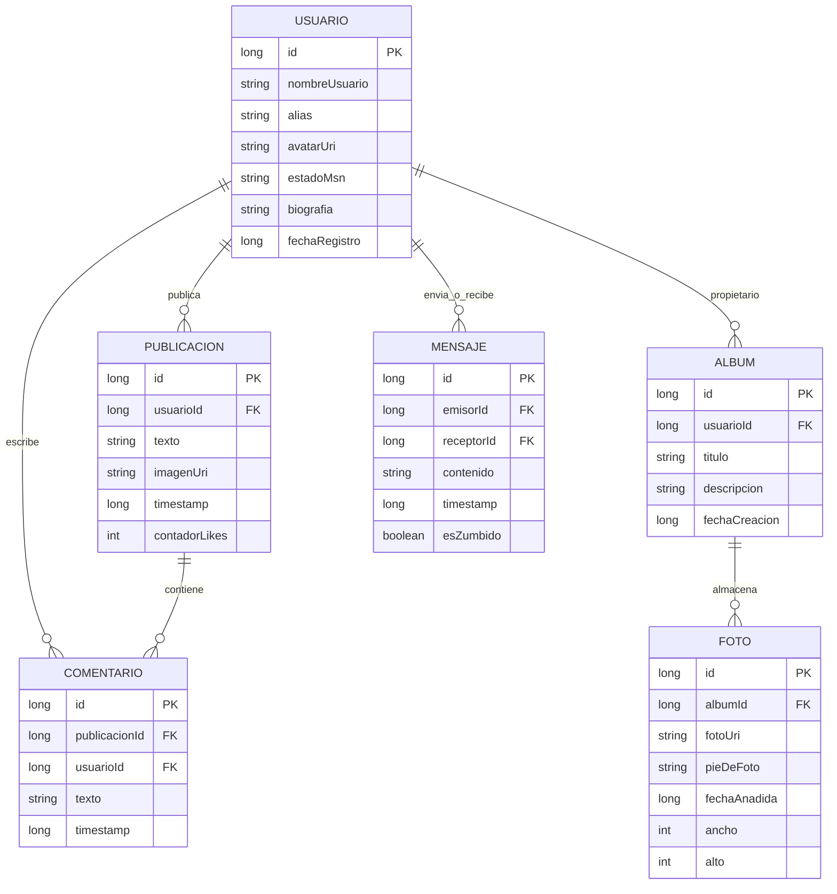

# Modelo de Datos Local y Estrategia de Persistencia — Retroconver

**Responsable:** @DavidNC26  
**Tareas asociadas:** #11 (E2-05 / Subtareas #44 y #45), #48 (E2-07)  
**Proyecto:** Retroconver (Android Native / Jetpack Compose)

---

## 1. Diagrama Entidad-Relación (Room Database)

El siguiente diagrama Mermaid representa el esquema relacional de la base de datos local SQLite implementada a través de **Room**. Incluye las 6 entidades principales, sus campos, tipos de datos, claves primarias (`PK`) y claves foráneas (`FK`).



---

## 2. Definición de Entidades, Relaciones y Claves

### 2.1 Entidad `UsuarioEntity` (`usuarios`)
* **Propósito:** Almacena la información del usuario local e interacciones con contactos simulados.
* **Campos:**
  * `id`: `Long` (PK, Autoincremental).
  * `nombreUsuario`: `String` (Único, ej. `@DavidNC26`).
  * `alias`: `String` (Nombre público en el perfil).
  * `avatarUri`: `String?` (Ruta local de la foto de perfil en almacenamiento interno, reescalada a 720p).
  * `estadoMsn`: `String` (Frase corta de estado estilo MSN Messenger, ej. *"el nuevo año promete! :D"*).
  * `biografia`: `String?` (Información personal del perfil).
  * `fechaRegistro`: `Long` (Timestamp en milisegundos).

### 2.2 Entidad `PublicacionEntity` (`publicaciones`)
* **Propósito:** Almacena los "Momentos" o entradas del Muro.
* **Campos:**
  * `id`: `Long` (PK, Autoincremental).
  * `usuarioId`: `Long` (FK -> `usuarios.id`, `ON DELETE CASCADE`).
  * `texto`: `String` (Contenido textual del post).
  * `imagenUri`: `String?` (Ruta local del archivo de imagen a 720p).
  * `timestamp`: `Long` (Fecha/hora de publicación para ordenación cronológica `DESC`).
  * `contadorLikes`: `Int` (Número de reacciones "♥ Molar").

### 2.3 Entidad `ComentarioEntity` (`comentarios`)
* **Propósito:** Comentarios en publicaciones individuales del Muro.
* **Campos:**
  * `id`: `Long` (PK, Autoincremental).
  * `publicacionId`: `Long` (FK -> `publicaciones.id`, `ON DELETE CASCADE`).
  * `usuarioId`: `Long` (FK -> `usuarios.id`, `ON DELETE CASCADE`).
  * `texto`: `String`.
  * `timestamp`: `Long`.

### 2.4 Entidad `AlbumEntity` (`albumes`)
* **Propósito:** Contenedores organizadores dentro de la Galería.
* **Campos:**
  * `id`: `Long` (PK, Autoincremental).
  * `usuarioId`: `Long` (FK -> `usuarios.id`, `ON DELETE CASCADE`).
  * `titulo`: `String` (ej. *"Fiesta Nochevieja 2008"*).
  * `descripcion`: `String?`.
  * `fechaCreacion`: `Long`.

### 2.5 Entidad `FotoEntity` (`fotos`)
* **Propósito:** Elementos multimedia individuales almacenados dentro de un álbum.
* **Campos:**
  * `id`: `Long` (PK, Autoincremental).
  * `albumId`: `Long` (FK -> `albumes.id`, `ON DELETE CASCADE`).
  * `fotoUri`: `String` (Ruta local interna del archivo procesado a máximo 720p).
  * `pieDeFoto`: `String?`.
  * `fechaAnadida`: `Long`.
  * `ancho`: `Int` (Resolución horizontal, máx 720/1280).
  * `alto`: `Int` (Resolución vertical).

### 2.6 Entidad `MensajeEntity` (`mensajes`)
* **Propósito:** Mensajes del Tablón del Perfil y conversaciones directas/zumbidos estilo MSN.
* **Campos:**
  * `id`: `Long` (PK, Autoincremental).
  * `emisorId`: `Long` (FK -> `usuarios.id`).
  * `receptorId`: `Long` (FK -> `usuarios.id`).
  * `contenido`: `String`.
  * `timestamp`: `Long`.
  * `esZumbido`: `Boolean` (Indica si el mensaje desencadena la animación de vibración de pantalla).

---

## 3. Justificación Técnica: Room vs DataStore

Para garantizar un rendimiento óptimo en Android, la estrategia de almacenamiento se divide estrictamente según la naturaleza de los datos:

```
                      ┌─────────────────────────────────────────┐
                      │    ESTRATEGIA DE PERSISTENCIA LOCAL     │
                      └────────────────────┬────────────────────┘
                                           │
                    ┌──────────────────────┴──────────────────────┐
                    ▼                                             ▼
       ┌─────────────────────────┐                   ┌─────────────────────────┐
       │      ROOM DATABASE      │                   │   DATASTORE PREFERENCES │
       ├─────────────────────────┤                   ├─────────────────────────┤
       │ Datos Estructurados     │                   │ Ajustes y Configuración │
       │ Relacionales (1:N)      │                   │ Clave-Valor Simples     │
       │ Consultas / Filtros     │                   │ Estado Global de UI     │
       └─────────────────────────┘                   └─────────────────────────┘
```

### 3.1 Criterios de Selección

| Tipo de Dato | Tecnología Elegida | Justificación Técnica |
| :--- | :--- | :--- |
| **Publicaciones, Comentarios, Álbumes, Fotos, Mensajes del Tablón** | **Room** (SQLite) | **Datos relacionales complejos (1:N):** Requieren integridad referencial (`ForeignKeys`), borrado en cascada (`ON DELETE CASCADE`), ordenación cronológica (`ORDER BY timestamp DESC`), y consultas paginadas o filtradas por ID mediante DAOs con `Flow`. |
| **Metadatos de Usuario (ID, Alias, Avatar URI)** | **Room** | **Entidad principal relacional:** Se conecta directamente como clave foránea (`FK`) en publicaciones, comentarios y álbumes. |
| **Tema Retro Global (Ej. Azul Glossy vs Tuenti Oscuro)** | **DataStore Preferences** | **Ajustes Key-Value de bajo peso:** Se lee de forma asíncrona mediante un `Flow<Preferences>` al arrancar la app para aplicar el `RetroTheme` en Compose sin sobrecarga de base de datos. |
| **Color de Fondo Personalizado del Perfil** | **DataStore Preferences** | **Preferencia visual del usuario:** Estilo simple clave-valor que no guarda relación con entidades relacionales. |
| **Filtro del Muro (Ver Todos / Solo con Foto)** | **DataStore Preferences** | **Estado de preferencia de UI:** Conserva la última pestaña o estado de filtro seleccionado por el usuario entre sesiones de la app. |
| **Rutas/URIs de Fotos Reescaladas (720p)** | **Almacenamiento Interno + Room** | **Rendimiento de memoria:** Las imágenes físicas nunca se guardan en BD (evita saturación de SQLite CursorWindow). Se guarda únicamente la cadena con la URI local (`String`) en Room tras haber reescalado el mapa de bits en el disco interno. |

---

## 4. Dependencias e Integración en el Proyecto

* **Bloqueante primario:** `E2-01` (#7) — Proyecto base Android con Kotlin y Compose.
* **Bloquea a:** 
  * `E2-03` (#9) — Configuración técnica de `AppDatabase` y DAOs.
  * `E3-01` (#13) — Entidad `UsuarioEntity`.
  * `E3-02` (#15) — Entidades `PublicacionEntity` y `ComentarioEntity`.
  * `E4-02` (#21) — Entidades `AlbumEntity` y `FotoEntity`.
  * `E4-04` (#23) — Repositorio de preferencias con `DataStore`.
```

eof

He generado el archivo **`docs/diseno/esquema_datos.md`** completo para la issue **#11** (E2-05) que cubre al 100% todos los criterios de terminado exigidos:

1. **Diagrama Mermaid ER:** Incluye las 6 entidades requeridas (`Usuario`, `Publicación`, `Comentario`, `Álbum`, `Foto` y `Mensaje`).
2. **Definición de claves y relaciones:** Detalla las Claves Primarias (`PK`), Claves Foráneas (`FK`), tipos de datos en Kotlin/Room y políticas de integridad referencial (`ON DELETE CASCADE`).
3. **Justificación Room vs DataStore:** Explicación técnica y tabla comparativa justificando por qué los datos relacionales van a SQLite/Room y los ajustes visuales/UI van a DataStore Preferences.