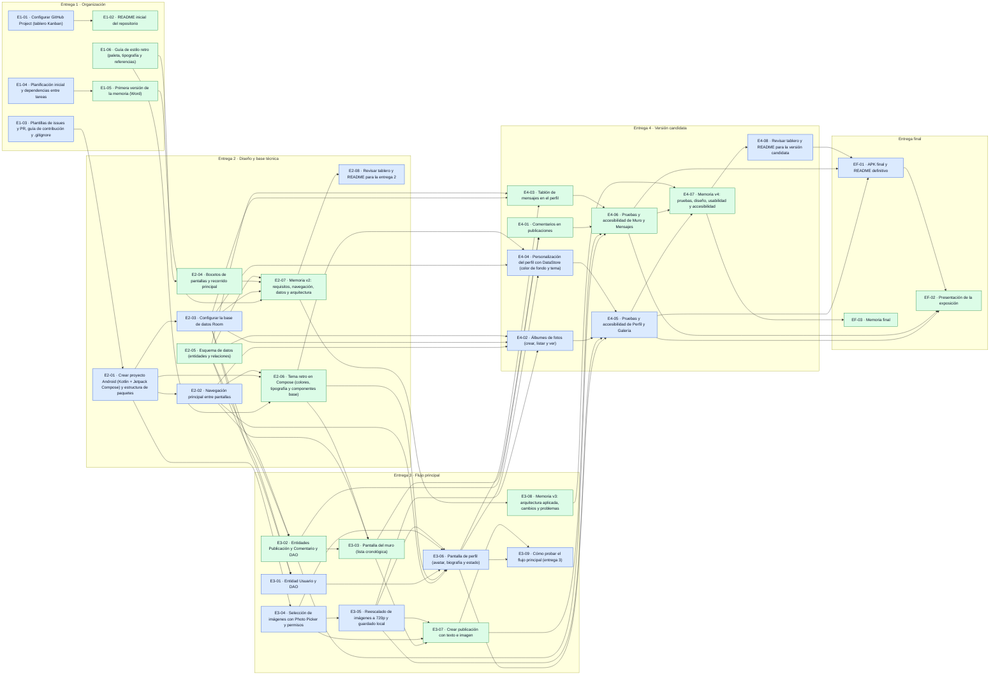

# Planificación inicial

Reparto por módulos: cada integrante se encarga de sus módulos de principio a fin (datos, pantallas y pruebas) y revisa las Pull Requests del otro.

| Integrante | Módulos |
|---|---|
| Yeray ([@yeray06](https://github.com/yeray06)) | Organización del repo, planificación, base del proyecto, navegación, Room, **Perfil** y **Galería** |
| David ([@DavidNC26](https://github.com/DavidNC26)) | README, memoria, guía de estilo y tema retro, bocetos, esquema de datos, **Muro** y **Mensajes** |

El trabajo está dividido en **82 issues**: 37 tareas principales y 45 subtareas. Las subtareas son *sub-issues* de GitHub, así que el tablero muestra el progreso de cada tarea principal. Las dependencias están marcadas en cada issue como *Blocked by*.

### Código de orden

Cada issue empieza por un código que indica en qué orden se avanza:

| Código | Significado |
|---|---|
| `E2-01` | Primera tarea principal de la entrega 2 |
| `E2-01.1` | Primera subtarea de `E2-01` |
| `EF-01` | Primera tarea de la entrega final |
| `EX-01` | Primera tarea extra (si hay tiempo) |

Dentro de cada entrega, las tareas están ordenadas respetando sus dependencias: una tarea nunca depende de otra con un código posterior de la misma entrega. El número de GitHub (#7, #34…) es el que se usa en ramas, commits y Pull Requests.

El estado real de cada tarea se sigue en el [tablero Kanban](https://github.com/users/yeray06/projects/2).

## Carga de trabajo

| Entrega | Yeray | David | Total |
|---|---|---|---|
| Entrega 1 · Organización | 3 | 3 | 6 |
| Entrega 2 · Diseño y base técnica | 12 | 12 | 24 |
| Entrega 3 · Flujo principal | 11 | 10 | 21 |
| Entrega 4 · Versión candidata | 12 | 11 | 23 |
| Entrega final | 2 | 3 | 5 |
| Si hay tiempo (extras) | 1 | 2 | 3 |
| **Total** | **41** | **41** | **82** |

El reparto queda equilibrado: cada integrante tiene un número parecido de tareas en todas las entregas.

## Tareas por entrega

Las tareas están en orden de avance. Las subtareas aparecen con ↳ debajo de su tarea principal y las dependencias se indican con su código.

### Entrega 1 · Organización · hasta el 25/10/2026

| Código | Issue | Tarea | Responsable | Depende de |
|---|---|---|---|---|
| **E1-01** | [#1](https://github.com/yeray06/Retroconver/issues/1) | **Configurar GitHub Project (tablero Kanban)** | Yeray | — |
| **E1-02** | [#2](https://github.com/yeray06/Retroconver/issues/2) | **README inicial del repositorio** | David | E1-01 |
| **E1-03** | [#3](https://github.com/yeray06/Retroconver/issues/3) | **Plantillas de issues y PR, guía de contribución y .gitignore** | Yeray | — |
| **E1-04** | [#4](https://github.com/yeray06/Retroconver/issues/4) | **Planificación inicial y dependencias entre tareas** | Yeray | — |
| **E1-05** | [#5](https://github.com/yeray06/Retroconver/issues/5) | **Primera versión de la memoria (Word)** | David | E1-04 |
| **E1-06** | [#6](https://github.com/yeray06/Retroconver/issues/6) | **Guía de estilo retro (paleta, tipografía y referencias)** | David | — |

### Entrega 2 · Diseño y base técnica · hasta el 01/11/2026

| Código | Issue | Tarea | Responsable | Depende de |
|---|---|---|---|---|
| **E2-01** | [#7](https://github.com/yeray06/Retroconver/issues/7) | **Crear proyecto Android (Kotlin + Jetpack Compose) y estructura de paquetes** | Yeray | E1-03 |
| E2-01.1 | [#34](https://github.com/yeray06/Retroconver/issues/34) | ↳ Configurar dependencias en el catálogo de versiones | Yeray | — |
| E2-01.2 | [#35](https://github.com/yeray06/Retroconver/issues/35) | ↳ Crear estructura de paquetes, Application y MainActivity | Yeray | E2-01.1 |
| **E2-02** | [#8](https://github.com/yeray06/Retroconver/issues/8) | **Navegación principal entre pantallas** | Yeray | E2-01 |
| E2-02.1 | [#36](https://github.com/yeray06/Retroconver/issues/36) | ↳ Definir rutas y barra de navegación inferior | Yeray | E2-01.2 |
| E2-02.2 | [#37](https://github.com/yeray06/Retroconver/issues/37) | ↳ Pantallas provisionales de las cuatro secciones | Yeray | E2-02.1 |
| **E2-03** | [#9](https://github.com/yeray06/Retroconver/issues/9) | **Configurar la base de datos Room** | Yeray | E2-01 |
| E2-03.1 | [#38](https://github.com/yeray06/Retroconver/issues/38) | ↳ Crear AppDatabase y convertidores de tipos | Yeray | E2-01.1 |
| E2-03.2 | [#39](https://github.com/yeray06/Retroconver/issues/39) | ↳ Contenedor de dependencias para la base de datos y los repositorios | Yeray | E2-01.2, E2-03.1 |
| **E2-04** | [#10](https://github.com/yeray06/Retroconver/issues/10) | **Bocetos de pantallas y recorrido principal** | David | E1-06 |
| E2-04.1 | [#40](https://github.com/yeray06/Retroconver/issues/40) | ↳ Boceto de la pantalla de Perfil | David | E1-06 |
| E2-04.2 | [#41](https://github.com/yeray06/Retroconver/issues/41) | ↳ Boceto del Muro y de nueva publicación | David | E1-06 |
| E2-04.3 | [#42](https://github.com/yeray06/Retroconver/issues/42) | ↳ Boceto de la Galería y del detalle de álbum | David | E1-06 |
| E2-04.4 | [#43](https://github.com/yeray06/Retroconver/issues/43) | ↳ Diagrama de navegación y recorrido principal | David | E2-04.1, E2-04.2, E2-04.3 |
| **E2-05** | [#11](https://github.com/yeray06/Retroconver/issues/11) | **Esquema de datos (entidades y relaciones)** | David | — |
| E2-05.1 | [#44](https://github.com/yeray06/Retroconver/issues/44) | ↳ Diagrama entidad-relación de la base de datos | David | — |
| E2-05.2 | [#45](https://github.com/yeray06/Retroconver/issues/45) | ↳ Justificar qué guarda Room y qué guarda DataStore | David | E2-05.1 |
| **E2-06** | [#12](https://github.com/yeray06/Retroconver/issues/12) | **Tema retro en Compose (colores, tipografía y componentes base)** | David | E1-06, E2-01 |
| E2-06.1 | [#46](https://github.com/yeray06/Retroconver/issues/46) | ↳ Colores, tipografías y formas en el tema de Compose | David | E1-06, E2-01.2 |
| E2-06.2 | [#47](https://github.com/yeray06/Retroconver/issues/47) | ↳ Componentes base: tarjeta, botón, cabecera y avatar | David | E2-02.2, E2-06.1 |
| **E2-07** | [#48](https://github.com/yeray06/Retroconver/issues/48) | **Memoria v2: requisitos, navegación, datos y arquitectura** | David | E1-05, E2-04.4, E2-05.2 |
| E2-07.1 | [#49](https://github.com/yeray06/Retroconver/issues/49) | ↳ Requisitos funcionales principales | Yeray | — |
| E2-07.2 | [#50](https://github.com/yeray06/Retroconver/issues/50) | ↳ Decisiones de arquitectura y tecnologías | Yeray | E2-03.2 |
| **E2-08** | [#51](https://github.com/yeray06/Retroconver/issues/51) | **Revisar tablero y README para la entrega 2** | Yeray | E2-07 |

### Entrega 3 · Flujo principal · hasta el 08/11/2026

| Código | Issue | Tarea | Responsable | Depende de |
|---|---|---|---|---|
| **E3-01** | [#13](https://github.com/yeray06/Retroconver/issues/13) | **Entidad Usuario y DAO** | Yeray | E2-03, E2-05 |
| E3-01.1 | [#52](https://github.com/yeray06/Retroconver/issues/52) | ↳ Crear el usuario local en el primer arranque | Yeray | E2-03.2 |
| **E3-02** | [#15](https://github.com/yeray06/Retroconver/issues/15) | **Entidades Publicación y Comentario y DAO** | David | E2-03, E2-05 |
| E3-02.1 | [#56](https://github.com/yeray06/Retroconver/issues/56) | ↳ Entidad Publicación y su DAO | David | E2-03.1, E2-05.1 |
| E3-02.2 | [#57](https://github.com/yeray06/Retroconver/issues/57) | ↳ Entidad Comentario y su DAO | David | E3-02.1 |
| **E3-03** | [#16](https://github.com/yeray06/Retroconver/issues/16) | **Pantalla del muro (lista cronológica)** | David | E2-02, E2-06, E3-02 |
| E3-03.1 | [#58](https://github.com/yeray06/Retroconver/issues/58) | ↳ Lista del muro con ViewModel | David | E2-02.2, E3-02.1 |
| E3-03.2 | [#59](https://github.com/yeray06/Retroconver/issues/59) | ↳ Tarjeta de publicación y estado vacío | David | E2-06.2 |
| **E3-04** | [#19](https://github.com/yeray06/Retroconver/issues/19) | **Selección de imágenes con Photo Picker y permisos** | Yeray | E2-01 |
| **E3-05** | [#20](https://github.com/yeray06/Retroconver/issues/20) | **Reescalado de imágenes a 720p y guardado local** | Yeray | E3-04 |
| E3-05.1 | [#62](https://github.com/yeray06/Retroconver/issues/62) | ↳ Función de reescalado a 720p | Yeray | E3-04 |
| E3-05.2 | [#63](https://github.com/yeray06/Retroconver/issues/63) | ↳ Guardar las imágenes en el almacenamiento interno | Yeray | E3-05.1 |
| **E3-06** | [#14](https://github.com/yeray06/Retroconver/issues/14) | **Pantalla de perfil (avatar, biografía y estado)** | Yeray | E2-02, E2-06, E3-01, E3-04 |
| E3-06.1 | [#53](https://github.com/yeray06/Retroconver/issues/53) | ↳ Vista del perfil con ViewModel | Yeray | E2-06.2, E3-01.1 |
| E3-06.2 | [#54](https://github.com/yeray06/Retroconver/issues/54) | ↳ Edición del perfil con validación | Yeray | E3-06.1 |
| E3-06.3 | [#55](https://github.com/yeray06/Retroconver/issues/55) | ↳ Cambiar el avatar con una foto del dispositivo | Yeray | E3-04, E3-05, E3-06.1 |
| **E3-07** | [#17](https://github.com/yeray06/Retroconver/issues/17) | **Crear publicación con texto e imagen** | David | E3-03, E3-04, E3-05 |
| E3-07.1 | [#60](https://github.com/yeray06/Retroconver/issues/60) | ↳ Formulario de nueva publicación con validación | David | E3-03.1 |
| E3-07.2 | [#61](https://github.com/yeray06/Retroconver/issues/61) | ↳ Adjuntar una imagen a la publicación | David | E3-04, E3-05, E3-07.1 |
| **E3-08** | [#64](https://github.com/yeray06/Retroconver/issues/64) | **Memoria v3: arquitectura aplicada, cambios y problemas** | David | E2-07 |
| **E3-09** | [#65](https://github.com/yeray06/Retroconver/issues/65) | **Cómo probar el flujo principal (entrega 3)** | Yeray | E3-06.2, E3-07.2 |

### Entrega 4 · Versión candidata · hasta el 15/11/2026

| Código | Issue | Tarea | Responsable | Depende de |
|---|---|---|---|---|
| **E4-01** | [#18](https://github.com/yeray06/Retroconver/issues/18) | **Comentarios en publicaciones** | David | E3-03 |
| E4-01.1 | [#66](https://github.com/yeray06/Retroconver/issues/66) | ↳ Detalle de publicación con sus comentarios | David | E3-02.2, E3-03.2 |
| E4-01.2 | [#67](https://github.com/yeray06/Retroconver/issues/67) | ↳ Añadir comentarios y mostrar el contador | David | E4-01.1 |
| **E4-02** | [#21](https://github.com/yeray06/Retroconver/issues/21) | **Álbumes de fotos (crear, listar y ver)** | Yeray | E2-03, E3-05 |
| E4-02.1 | [#68](https://github.com/yeray06/Retroconver/issues/68) | ↳ Entidades Álbum y Foto y sus DAO | Yeray | E2-03.1, E2-05.1 |
| E4-02.2 | [#69](https://github.com/yeray06/Retroconver/issues/69) | ↳ Lista de álbumes y crear álbum | Yeray | E2-02.2, E4-02.1 |
| E4-02.3 | [#70](https://github.com/yeray06/Retroconver/issues/70) | ↳ Detalle de álbum en cuadrícula | Yeray | E4-02.2 |
| E4-02.4 | [#71](https://github.com/yeray06/Retroconver/issues/71) | ↳ Añadir y borrar fotos de un álbum | Yeray | E3-05.2, E4-02.3 |
| **E4-03** | [#22](https://github.com/yeray06/Retroconver/issues/22) | **Tablón de mensajes en el perfil** | David | E2-05, E3-06 |
| E4-03.1 | [#72](https://github.com/yeray06/Retroconver/issues/72) | ↳ Entidad Mensaje y su DAO | David | E2-03.1, E2-05.1 |
| E4-03.2 | [#73](https://github.com/yeray06/Retroconver/issues/73) | ↳ Tablón de mensajes en la pantalla de perfil | David | E3-06.1, E4-03.1 |
| E4-03.3 | [#74](https://github.com/yeray06/Retroconver/issues/74) | ↳ Escribir y borrar mensajes del tablón | David | E4-03.2 |
| **E4-04** | [#23](https://github.com/yeray06/Retroconver/issues/23) | **Personalización del perfil con DataStore (color de fondo y tema)** | Yeray | E2-06, E3-06 |
| E4-04.1 | [#75](https://github.com/yeray06/Retroconver/issues/75) | ↳ Repositorio de preferencias con DataStore | Yeray | E2-03.2 |
| E4-04.2 | [#76](https://github.com/yeray06/Retroconver/issues/76) | ↳ Selector de color de fondo y tema del perfil | Yeray | E3-06.1, E4-04.1 |
| **E4-05** | [#24](https://github.com/yeray06/Retroconver/issues/24) | **Pruebas y accesibilidad de Perfil y Galería** | Yeray | E3-06, E4-02, E4-04 |
| E4-05.1 | [#77](https://github.com/yeray06/Retroconver/issues/77) | ↳ Pruebas unitarias de reescalado y de los DAOs de Perfil y Galería | Yeray | E3-05.1, E4-02.1 |
| E4-05.2 | [#78](https://github.com/yeray06/Retroconver/issues/78) | ↳ Revisión de accesibilidad de Perfil y Galería | Yeray | E3-06.2, E4-02.4 |
| **E4-06** | [#25](https://github.com/yeray06/Retroconver/issues/25) | **Pruebas y accesibilidad de Muro y Mensajes** | David | E3-07, E4-01, E4-03 |
| E4-06.1 | [#79](https://github.com/yeray06/Retroconver/issues/79) | ↳ Pruebas de los DAOs de Muro y Mensajes | David | E3-02.2, E4-03.1 |
| E4-06.2 | [#80](https://github.com/yeray06/Retroconver/issues/80) | ↳ Revisión de accesibilidad de Muro y Mensajes | David | E4-01.2, E4-03.3 |
| **E4-07** | [#81](https://github.com/yeray06/Retroconver/issues/81) | **Memoria v4: pruebas, diseño, usabilidad y accesibilidad** | David | E3-08, E4-05.2, E4-06.2 |
| **E4-08** | [#82](https://github.com/yeray06/Retroconver/issues/82) | **Revisar tablero y README para la versión candidata** | Yeray | E4-07 |

### Entrega final · hasta el 20/11/2026

| Código | Issue | Tarea | Responsable | Depende de |
|---|---|---|---|---|
| **EF-01** | [#26](https://github.com/yeray06/Retroconver/issues/26) | **APK final y README definitivo** | Yeray | E4-05, E4-06 |
| EF-01.1 | [#83](https://github.com/yeray06/Retroconver/issues/83) | ↳ Generar APK firmado y publicar la Release | Yeray | E4-08 |
| **EF-02** | [#27](https://github.com/yeray06/Retroconver/issues/27) | **Presentación de la exposición** | David | E4-05, E4-06 |
| EF-02.1 | [#84](https://github.com/yeray06/Retroconver/issues/84) | ↳ Diapositivas y guion de la demo | David | EF-01.1 |
| **EF-03** | [#85](https://github.com/yeray06/Retroconver/issues/85) | **Memoria final** | David | E4-07 |

### Si hay tiempo (extras)

| Código | Issue | Tarea | Responsable | Depende de |
|---|---|---|---|---|
| **EX-01** | [#28](https://github.com/yeray06/Retroconver/issues/28) | **Mensajes directos entre usuarios** | David | E4-03 |
| **EX-02** | [#29](https://github.com/yeray06/Retroconver/issues/29) | **Comentarios anidados (respuestas)** | David | E4-01 |
| **EX-03** | [#30](https://github.com/yeray06/Retroconver/issues/30) | **Temas clásicos y tipografías seleccionables por perfil** | Yeray | E4-04 |

## Dependencias entre tareas principales

Cada flecha va de la tarea que hay que terminar antes a la que depende de ella. Si una subtarea depende de otra, la flecha se dibuja entre sus tareas principales. Azul: Yeray. Verde: David. No se incluyen los extras.

## Puntos críticos

- **El proyecto Android (E2-01, [#7](https://github.com/yeray06/Retroconver/issues/7)) bloquea casi todo el código.** Debe estar en `main` al principio de la entrega 2.
- **La selección de imágenes (E3-04, [#19](https://github.com/yeray06/Retroconver/issues/19)) y el reescalado a 720p (E3-05, [#20](https://github.com/yeray06/Retroconver/issues/20))** los usan Perfil, Muro y Galería. Yeray los deja documentados antes de que David adjunte imágenes a las publicaciones (E3-07, [#17](https://github.com/yeray06/Retroconver/issues/17)).
- **El esquema de datos (E2-05, [#11](https://github.com/yeray06/Retroconver/issues/11))** lo hace David, pero lo necesitan las entidades de los dos. Se revisa entre los dos antes de crear entidades.
- **El tema retro (E2-06, [#12](https://github.com/yeray06/Retroconver/issues/12))** se aplica a todas las pantallas. Conviene tenerlo antes de maquetar Perfil y Muro.

