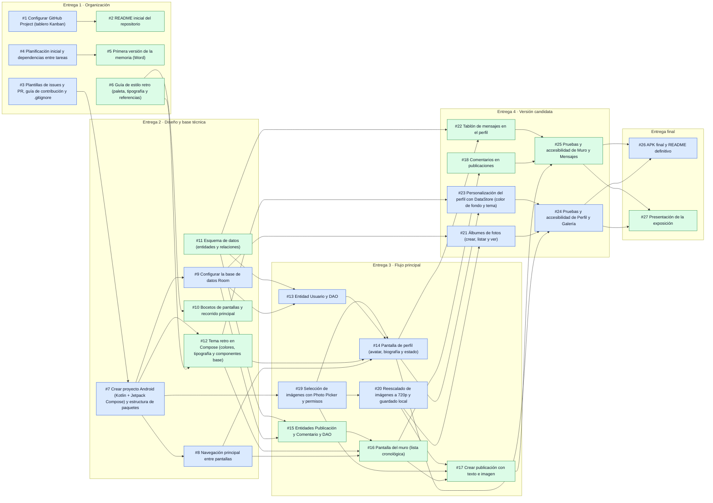

# Planificación inicial

Reparto por módulos: cada integrante se encarga de sus módulos de principio a fin (datos, pantallas y pruebas) y revisa las Pull Requests del otro.

| Integrante | Módulos |
|---|---|
| Yeray ([@yeray06](https://github.com/yeray06)) | Organización del repo, planificación, base del proyecto, navegación, Room, **Perfil** y **Galería** |
| David ([@DavidNC26](https://github.com/DavidNC26)) | README, memoria, guía de estilo y tema retro, bocetos, esquema de datos, **Muro** y **Mensajes** |

El estado real de cada tarea se sigue en el [tablero Kanban](https://github.com/users/yeray06/projects/2). Las dependencias también están marcadas en cada issue como *Blocked by*.

## Carga de trabajo

| Entrega | Yeray | David |
|---|---|---|
| Entrega 1 · Organización | 3 | 3 |
| Entrega 2 · Diseño y base técnica | 3 | 3 |
| Entrega 3 · Flujo principal | 4 | 3 |
| Entrega 4 · Versión candidata | 3 | 3 |
| Entrega final | 1 | 1 |
| Si hay tiempo (extras) | 1 | 2 |
| **Total sin extras** | **14** | **13** |

El reparto queda equilibrado: cada integrante tiene un número parecido de tareas en todas las entregas.

## Tareas por entrega

### Entrega 1 · Organización · hasta el 25/10/2026

| Issue | Tarea | Responsable | Depende de |
|---|---|---|---|
| [#1](https://github.com/yeray06/Retroconver/issues/1) | Configurar GitHub Project (tablero Kanban) | Yeray | — |
| [#2](https://github.com/yeray06/Retroconver/issues/2) | README inicial del repositorio | David | [#1](https://github.com/yeray06/Retroconver/issues/1) |
| [#3](https://github.com/yeray06/Retroconver/issues/3) | Plantillas de issues y PR, guía de contribución y .gitignore | Yeray | — |
| [#4](https://github.com/yeray06/Retroconver/issues/4) | Planificación inicial y dependencias entre tareas | Yeray | — |
| [#5](https://github.com/yeray06/Retroconver/issues/5) | Primera versión de la memoria (Word) | David | [#4](https://github.com/yeray06/Retroconver/issues/4) |
| [#6](https://github.com/yeray06/Retroconver/issues/6) | Guía de estilo retro (paleta, tipografía y referencias) | David | — |

### Entrega 2 · Diseño y base técnica · hasta el 01/11/2026

| Issue | Tarea | Responsable | Depende de |
|---|---|---|---|
| [#7](https://github.com/yeray06/Retroconver/issues/7) | Crear proyecto Android (Kotlin + Jetpack Compose) y estructura de paquetes | Yeray | [#3](https://github.com/yeray06/Retroconver/issues/3) |
| [#8](https://github.com/yeray06/Retroconver/issues/8) | Navegación principal entre pantallas | Yeray | [#7](https://github.com/yeray06/Retroconver/issues/7) |
| [#9](https://github.com/yeray06/Retroconver/issues/9) | Configurar la base de datos Room | Yeray | [#7](https://github.com/yeray06/Retroconver/issues/7) |
| [#10](https://github.com/yeray06/Retroconver/issues/10) | Bocetos de pantallas y recorrido principal | David | [#6](https://github.com/yeray06/Retroconver/issues/6) |
| [#11](https://github.com/yeray06/Retroconver/issues/11) | Esquema de datos (entidades y relaciones) | David | — |
| [#12](https://github.com/yeray06/Retroconver/issues/12) | Tema retro en Compose (colores, tipografía y componentes base) | David | [#6](https://github.com/yeray06/Retroconver/issues/6), [#7](https://github.com/yeray06/Retroconver/issues/7) |

### Entrega 3 · Flujo principal · hasta el 08/11/2026

| Issue | Tarea | Responsable | Depende de |
|---|---|---|---|
| [#13](https://github.com/yeray06/Retroconver/issues/13) | Entidad Usuario y DAO | Yeray | [#9](https://github.com/yeray06/Retroconver/issues/9), [#11](https://github.com/yeray06/Retroconver/issues/11) |
| [#14](https://github.com/yeray06/Retroconver/issues/14) | Pantalla de perfil (avatar, biografía y estado) | Yeray | [#8](https://github.com/yeray06/Retroconver/issues/8), [#12](https://github.com/yeray06/Retroconver/issues/12), [#13](https://github.com/yeray06/Retroconver/issues/13), [#19](https://github.com/yeray06/Retroconver/issues/19) |
| [#15](https://github.com/yeray06/Retroconver/issues/15) | Entidades Publicación y Comentario y DAO | David | [#9](https://github.com/yeray06/Retroconver/issues/9), [#11](https://github.com/yeray06/Retroconver/issues/11) |
| [#16](https://github.com/yeray06/Retroconver/issues/16) | Pantalla del muro (lista cronológica) | David | [#8](https://github.com/yeray06/Retroconver/issues/8), [#12](https://github.com/yeray06/Retroconver/issues/12), [#15](https://github.com/yeray06/Retroconver/issues/15) |
| [#17](https://github.com/yeray06/Retroconver/issues/17) | Crear publicación con texto e imagen | David | [#16](https://github.com/yeray06/Retroconver/issues/16), [#19](https://github.com/yeray06/Retroconver/issues/19), [#20](https://github.com/yeray06/Retroconver/issues/20) |
| [#19](https://github.com/yeray06/Retroconver/issues/19) | Selección de imágenes con Photo Picker y permisos | Yeray | [#7](https://github.com/yeray06/Retroconver/issues/7) |
| [#20](https://github.com/yeray06/Retroconver/issues/20) | Reescalado de imágenes a 720p y guardado local | Yeray | [#19](https://github.com/yeray06/Retroconver/issues/19) |

### Entrega 4 · Versión candidata · hasta el 15/11/2026

| Issue | Tarea | Responsable | Depende de |
|---|---|---|---|
| [#18](https://github.com/yeray06/Retroconver/issues/18) | Comentarios en publicaciones | David | [#16](https://github.com/yeray06/Retroconver/issues/16) |
| [#21](https://github.com/yeray06/Retroconver/issues/21) | Álbumes de fotos (crear, listar y ver) | Yeray | [#9](https://github.com/yeray06/Retroconver/issues/9), [#20](https://github.com/yeray06/Retroconver/issues/20) |
| [#22](https://github.com/yeray06/Retroconver/issues/22) | Tablón de mensajes en el perfil | David | [#11](https://github.com/yeray06/Retroconver/issues/11), [#14](https://github.com/yeray06/Retroconver/issues/14) |
| [#23](https://github.com/yeray06/Retroconver/issues/23) | Personalización del perfil con DataStore (color de fondo y tema) | Yeray | [#12](https://github.com/yeray06/Retroconver/issues/12), [#14](https://github.com/yeray06/Retroconver/issues/14) |
| [#24](https://github.com/yeray06/Retroconver/issues/24) | Pruebas y accesibilidad de Perfil y Galería | Yeray | [#14](https://github.com/yeray06/Retroconver/issues/14), [#21](https://github.com/yeray06/Retroconver/issues/21), [#23](https://github.com/yeray06/Retroconver/issues/23) |
| [#25](https://github.com/yeray06/Retroconver/issues/25) | Pruebas y accesibilidad de Muro y Mensajes | David | [#17](https://github.com/yeray06/Retroconver/issues/17), [#18](https://github.com/yeray06/Retroconver/issues/18), [#22](https://github.com/yeray06/Retroconver/issues/22) |

### Entrega final · hasta el 20/11/2026

| Issue | Tarea | Responsable | Depende de |
|---|---|---|---|
| [#26](https://github.com/yeray06/Retroconver/issues/26) | APK final y README definitivo | Yeray | [#24](https://github.com/yeray06/Retroconver/issues/24), [#25](https://github.com/yeray06/Retroconver/issues/25) |
| [#27](https://github.com/yeray06/Retroconver/issues/27) | Presentación de la exposición | David | [#24](https://github.com/yeray06/Retroconver/issues/24), [#25](https://github.com/yeray06/Retroconver/issues/25) |

### Si hay tiempo (extras)

| Issue | Tarea | Responsable | Depende de |
|---|---|---|---|
| [#28](https://github.com/yeray06/Retroconver/issues/28) | Mensajes directos entre usuarios | David | [#22](https://github.com/yeray06/Retroconver/issues/22) |
| [#29](https://github.com/yeray06/Retroconver/issues/29) | Comentarios anidados (respuestas) | David | [#18](https://github.com/yeray06/Retroconver/issues/18) |
| [#30](https://github.com/yeray06/Retroconver/issues/30) | Temas clásicos y tipografías seleccionables por perfil | Yeray | [#23](https://github.com/yeray06/Retroconver/issues/23) |

## Dependencias entre tareas

Cada flecha va de la tarea que hay que terminar antes a la tarea que depende de ella. Azul: Yeray. Verde: David. No se incluyen los extras.

## Puntos críticos

- **El proyecto Android ([#7](https://github.com/yeray06/Retroconver/issues/7)) bloquea casi todo el código.** Debe estar en `main` al principio de la entrega 2.
- **La selección de imágenes ([#19](https://github.com/yeray06/Retroconver/issues/19)) y el reescalado a 720p ([#20](https://github.com/yeray06/Retroconver/issues/20))** los usan Perfil, Muro y Galería. Yeray los deja documentados antes de que David empiece a crear publicaciones con imagen ([#17](https://github.com/yeray06/Retroconver/issues/17)).
- **El esquema de datos ([#11](https://github.com/yeray06/Retroconver/issues/11))** lo hace David, pero lo necesitan las entidades de los dos. Se revisa entre los dos antes de crear entidades.
- **El tema retro ([#12](https://github.com/yeray06/Retroconver/issues/12))** se aplica a todas las pantallas. Conviene tenerlo antes de maquetar Perfil y Muro.

