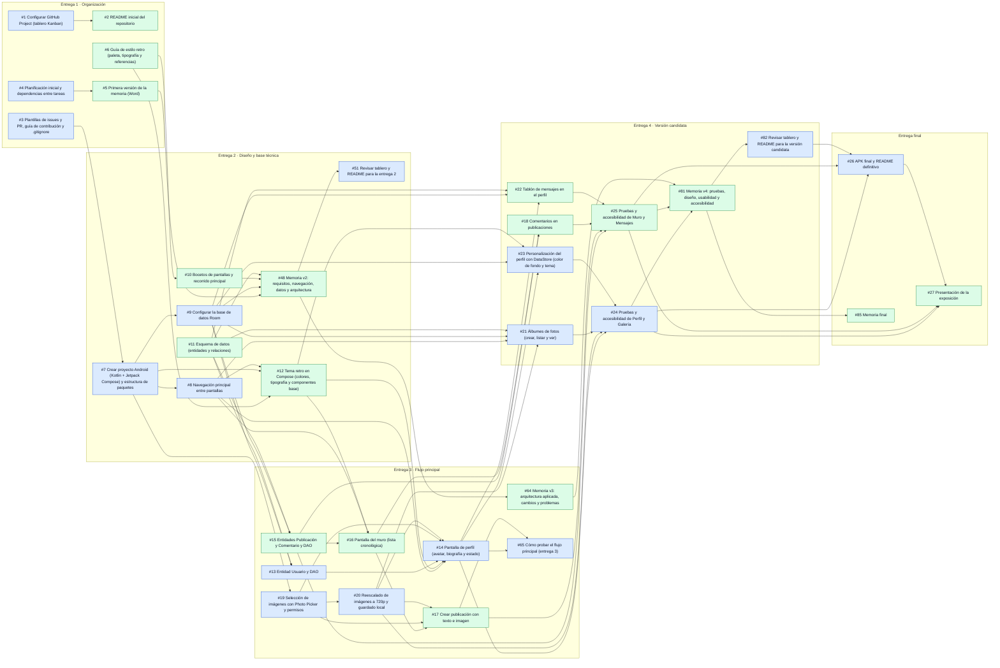

# Planificación inicial

Reparto por módulos: cada integrante se encarga de sus módulos de principio a fin (datos, pantallas y pruebas) y revisa las Pull Requests del otro.

| Integrante | Módulos |
|---|---|
| Yeray ([@yeray06](https://github.com/yeray06)) | Organización del repo, planificación, base del proyecto, navegación, Room, **Perfil** y **Galería** |
| David ([@DavidNC26](https://github.com/DavidNC26)) | README, memoria, guía de estilo y tema retro, bocetos, esquema de datos, **Muro** y **Mensajes** |

El trabajo está dividido en **82 issues**: 37 tareas principales y 45 subtareas. Las subtareas son *sub-issues* de GitHub, así que el tablero muestra el progreso de cada tarea principal. Las dependencias están marcadas en cada issue como *Blocked by*.

El estado real de cada tarea se sigue en el [tablero Kanban](https://github.com/users/yeray06/projects/2).

## Carga de trabajo

| Entrega | Yeray | David | Total |
|---|---|---|---|
| Entrega 1 · Organización | 3 | 3 | 6 |
| Entrega 2 · Diseño y base técnica | 12 | 12 | 24 |
| Entrega 3 · Flujo principal | 11 | 10 | 21 |
| Entrega 4 · Versión candidata | 12 | 11 | 23 |
| Entrega final | 2 | 3 | 5 |
| Si hay tiempo (extras) | 1 | 2 | 3 |
| **Total** | **41** | **41** | **82** |

El reparto queda equilibrado: cada integrante tiene un número parecido de tareas en todas las entregas.

## Tareas por entrega

Las subtareas aparecen con ↳ debajo de su tarea principal.

### Entrega 1 · Organización · hasta el 25/10/2026

| Issue | Tarea | Responsable | Depende de |
|---|---|---|---|
| [#1](https://github.com/yeray06/Retroconver/issues/1) | **Configurar GitHub Project (tablero Kanban)** | Yeray | — |
| [#2](https://github.com/yeray06/Retroconver/issues/2) | **README inicial del repositorio** | David | [#1](https://github.com/yeray06/Retroconver/issues/1) |
| [#3](https://github.com/yeray06/Retroconver/issues/3) | **Plantillas de issues y PR, guía de contribución y .gitignore** | Yeray | — |
| [#4](https://github.com/yeray06/Retroconver/issues/4) | **Planificación inicial y dependencias entre tareas** | Yeray | — |
| [#5](https://github.com/yeray06/Retroconver/issues/5) | **Primera versión de la memoria (Word)** | David | [#4](https://github.com/yeray06/Retroconver/issues/4) |
| [#6](https://github.com/yeray06/Retroconver/issues/6) | **Guía de estilo retro (paleta, tipografía y referencias)** | David | — |

### Entrega 2 · Diseño y base técnica · hasta el 01/11/2026

| Issue | Tarea | Responsable | Depende de |
|---|---|---|---|
| [#7](https://github.com/yeray06/Retroconver/issues/7) | **Crear proyecto Android (Kotlin + Jetpack Compose) y estructura de paquetes** | Yeray | [#3](https://github.com/yeray06/Retroconver/issues/3) |
| [#34](https://github.com/yeray06/Retroconver/issues/34) | ↳ Configurar dependencias en el catálogo de versiones | Yeray | — |
| [#35](https://github.com/yeray06/Retroconver/issues/35) | ↳ Crear estructura de paquetes, Application y MainActivity | Yeray | [#34](https://github.com/yeray06/Retroconver/issues/34) |
| [#8](https://github.com/yeray06/Retroconver/issues/8) | **Navegación principal entre pantallas** | Yeray | [#7](https://github.com/yeray06/Retroconver/issues/7) |
| [#36](https://github.com/yeray06/Retroconver/issues/36) | ↳ Definir rutas y barra de navegación inferior | Yeray | [#35](https://github.com/yeray06/Retroconver/issues/35) |
| [#37](https://github.com/yeray06/Retroconver/issues/37) | ↳ Pantallas provisionales de las cuatro secciones | Yeray | [#36](https://github.com/yeray06/Retroconver/issues/36) |
| [#9](https://github.com/yeray06/Retroconver/issues/9) | **Configurar la base de datos Room** | Yeray | [#7](https://github.com/yeray06/Retroconver/issues/7) |
| [#38](https://github.com/yeray06/Retroconver/issues/38) | ↳ Crear AppDatabase y convertidores de tipos | Yeray | [#34](https://github.com/yeray06/Retroconver/issues/34) |
| [#39](https://github.com/yeray06/Retroconver/issues/39) | ↳ Contenedor de dependencias para la base de datos y los repositorios | Yeray | [#38](https://github.com/yeray06/Retroconver/issues/38), [#35](https://github.com/yeray06/Retroconver/issues/35) |
| [#10](https://github.com/yeray06/Retroconver/issues/10) | **Bocetos de pantallas y recorrido principal** | David | [#6](https://github.com/yeray06/Retroconver/issues/6) |
| [#40](https://github.com/yeray06/Retroconver/issues/40) | ↳ Boceto de la pantalla de Perfil | David | [#6](https://github.com/yeray06/Retroconver/issues/6) |
| [#41](https://github.com/yeray06/Retroconver/issues/41) | ↳ Boceto del Muro y de nueva publicación | David | [#6](https://github.com/yeray06/Retroconver/issues/6) |
| [#42](https://github.com/yeray06/Retroconver/issues/42) | ↳ Boceto de la Galería y del detalle de álbum | David | [#6](https://github.com/yeray06/Retroconver/issues/6) |
| [#43](https://github.com/yeray06/Retroconver/issues/43) | ↳ Diagrama de navegación y recorrido principal | David | [#40](https://github.com/yeray06/Retroconver/issues/40), [#41](https://github.com/yeray06/Retroconver/issues/41), [#42](https://github.com/yeray06/Retroconver/issues/42) |
| [#11](https://github.com/yeray06/Retroconver/issues/11) | **Esquema de datos (entidades y relaciones)** | David | — |
| [#44](https://github.com/yeray06/Retroconver/issues/44) | ↳ Diagrama entidad-relación de la base de datos | David | — |
| [#45](https://github.com/yeray06/Retroconver/issues/45) | ↳ Justificar qué guarda Room y qué guarda DataStore | David | [#44](https://github.com/yeray06/Retroconver/issues/44) |
| [#12](https://github.com/yeray06/Retroconver/issues/12) | **Tema retro en Compose (colores, tipografía y componentes base)** | David | [#6](https://github.com/yeray06/Retroconver/issues/6), [#7](https://github.com/yeray06/Retroconver/issues/7) |
| [#46](https://github.com/yeray06/Retroconver/issues/46) | ↳ Colores, tipografías y formas en el tema de Compose | David | [#6](https://github.com/yeray06/Retroconver/issues/6), [#35](https://github.com/yeray06/Retroconver/issues/35) |
| [#47](https://github.com/yeray06/Retroconver/issues/47) | ↳ Componentes base: tarjeta, botón, cabecera y avatar | David | [#46](https://github.com/yeray06/Retroconver/issues/46), [#37](https://github.com/yeray06/Retroconver/issues/37) |
| [#48](https://github.com/yeray06/Retroconver/issues/48) | **Memoria v2: requisitos, navegación, datos y arquitectura** | David | [#43](https://github.com/yeray06/Retroconver/issues/43), [#45](https://github.com/yeray06/Retroconver/issues/45), [#5](https://github.com/yeray06/Retroconver/issues/5) |
| [#49](https://github.com/yeray06/Retroconver/issues/49) | ↳ Requisitos funcionales principales | Yeray | — |
| [#50](https://github.com/yeray06/Retroconver/issues/50) | ↳ Decisiones de arquitectura y tecnologías | Yeray | [#39](https://github.com/yeray06/Retroconver/issues/39) |
| [#51](https://github.com/yeray06/Retroconver/issues/51) | **Revisar tablero y README para la entrega 2** | Yeray | [#48](https://github.com/yeray06/Retroconver/issues/48) |

### Entrega 3 · Flujo principal · hasta el 08/11/2026

| Issue | Tarea | Responsable | Depende de |
|---|---|---|---|
| [#13](https://github.com/yeray06/Retroconver/issues/13) | **Entidad Usuario y DAO** | Yeray | [#9](https://github.com/yeray06/Retroconver/issues/9), [#11](https://github.com/yeray06/Retroconver/issues/11) |
| [#52](https://github.com/yeray06/Retroconver/issues/52) | ↳ Crear el usuario local en el primer arranque | Yeray | [#39](https://github.com/yeray06/Retroconver/issues/39) |
| [#14](https://github.com/yeray06/Retroconver/issues/14) | **Pantalla de perfil (avatar, biografía y estado)** | Yeray | [#8](https://github.com/yeray06/Retroconver/issues/8), [#12](https://github.com/yeray06/Retroconver/issues/12), [#13](https://github.com/yeray06/Retroconver/issues/13), [#19](https://github.com/yeray06/Retroconver/issues/19) |
| [#53](https://github.com/yeray06/Retroconver/issues/53) | ↳ Vista del perfil con ViewModel | Yeray | [#52](https://github.com/yeray06/Retroconver/issues/52), [#47](https://github.com/yeray06/Retroconver/issues/47) |
| [#54](https://github.com/yeray06/Retroconver/issues/54) | ↳ Edición del perfil con validación | Yeray | [#53](https://github.com/yeray06/Retroconver/issues/53) |
| [#55](https://github.com/yeray06/Retroconver/issues/55) | ↳ Cambiar el avatar con una foto del dispositivo | Yeray | [#53](https://github.com/yeray06/Retroconver/issues/53), [#19](https://github.com/yeray06/Retroconver/issues/19), [#20](https://github.com/yeray06/Retroconver/issues/20) |
| [#15](https://github.com/yeray06/Retroconver/issues/15) | **Entidades Publicación y Comentario y DAO** | David | [#9](https://github.com/yeray06/Retroconver/issues/9), [#11](https://github.com/yeray06/Retroconver/issues/11) |
| [#56](https://github.com/yeray06/Retroconver/issues/56) | ↳ Entidad Publicación y su DAO | David | [#38](https://github.com/yeray06/Retroconver/issues/38), [#44](https://github.com/yeray06/Retroconver/issues/44) |
| [#57](https://github.com/yeray06/Retroconver/issues/57) | ↳ Entidad Comentario y su DAO | David | [#56](https://github.com/yeray06/Retroconver/issues/56) |
| [#16](https://github.com/yeray06/Retroconver/issues/16) | **Pantalla del muro (lista cronológica)** | David | [#8](https://github.com/yeray06/Retroconver/issues/8), [#12](https://github.com/yeray06/Retroconver/issues/12), [#15](https://github.com/yeray06/Retroconver/issues/15) |
| [#58](https://github.com/yeray06/Retroconver/issues/58) | ↳ Lista del muro con ViewModel | David | [#56](https://github.com/yeray06/Retroconver/issues/56), [#37](https://github.com/yeray06/Retroconver/issues/37) |
| [#59](https://github.com/yeray06/Retroconver/issues/59) | ↳ Tarjeta de publicación y estado vacío | David | [#47](https://github.com/yeray06/Retroconver/issues/47) |
| [#17](https://github.com/yeray06/Retroconver/issues/17) | **Crear publicación con texto e imagen** | David | [#16](https://github.com/yeray06/Retroconver/issues/16), [#19](https://github.com/yeray06/Retroconver/issues/19), [#20](https://github.com/yeray06/Retroconver/issues/20) |
| [#60](https://github.com/yeray06/Retroconver/issues/60) | ↳ Formulario de nueva publicación con validación | David | [#58](https://github.com/yeray06/Retroconver/issues/58) |
| [#61](https://github.com/yeray06/Retroconver/issues/61) | ↳ Adjuntar una imagen a la publicación | David | [#60](https://github.com/yeray06/Retroconver/issues/60), [#19](https://github.com/yeray06/Retroconver/issues/19), [#20](https://github.com/yeray06/Retroconver/issues/20) |
| [#19](https://github.com/yeray06/Retroconver/issues/19) | **Selección de imágenes con Photo Picker y permisos** | Yeray | [#7](https://github.com/yeray06/Retroconver/issues/7) |
| [#20](https://github.com/yeray06/Retroconver/issues/20) | **Reescalado de imágenes a 720p y guardado local** | Yeray | [#19](https://github.com/yeray06/Retroconver/issues/19) |
| [#62](https://github.com/yeray06/Retroconver/issues/62) | ↳ Función de reescalado a 720p | Yeray | [#19](https://github.com/yeray06/Retroconver/issues/19) |
| [#63](https://github.com/yeray06/Retroconver/issues/63) | ↳ Guardar las imágenes en el almacenamiento interno | Yeray | [#62](https://github.com/yeray06/Retroconver/issues/62) |
| [#64](https://github.com/yeray06/Retroconver/issues/64) | **Memoria v3: arquitectura aplicada, cambios y problemas** | David | [#48](https://github.com/yeray06/Retroconver/issues/48) |
| [#65](https://github.com/yeray06/Retroconver/issues/65) | **Cómo probar el flujo principal (entrega 3)** | Yeray | [#54](https://github.com/yeray06/Retroconver/issues/54), [#61](https://github.com/yeray06/Retroconver/issues/61) |

### Entrega 4 · Versión candidata · hasta el 15/11/2026

| Issue | Tarea | Responsable | Depende de |
|---|---|---|---|
| [#18](https://github.com/yeray06/Retroconver/issues/18) | **Comentarios en publicaciones** | David | [#16](https://github.com/yeray06/Retroconver/issues/16) |
| [#66](https://github.com/yeray06/Retroconver/issues/66) | ↳ Detalle de publicación con sus comentarios | David | [#57](https://github.com/yeray06/Retroconver/issues/57), [#59](https://github.com/yeray06/Retroconver/issues/59) |
| [#67](https://github.com/yeray06/Retroconver/issues/67) | ↳ Añadir comentarios y mostrar el contador | David | [#66](https://github.com/yeray06/Retroconver/issues/66) |
| [#21](https://github.com/yeray06/Retroconver/issues/21) | **Álbumes de fotos (crear, listar y ver)** | Yeray | [#9](https://github.com/yeray06/Retroconver/issues/9), [#20](https://github.com/yeray06/Retroconver/issues/20) |
| [#68](https://github.com/yeray06/Retroconver/issues/68) | ↳ Entidades Álbum y Foto y sus DAO | Yeray | [#38](https://github.com/yeray06/Retroconver/issues/38), [#44](https://github.com/yeray06/Retroconver/issues/44) |
| [#69](https://github.com/yeray06/Retroconver/issues/69) | ↳ Lista de álbumes y crear álbum | Yeray | [#68](https://github.com/yeray06/Retroconver/issues/68), [#37](https://github.com/yeray06/Retroconver/issues/37) |
| [#70](https://github.com/yeray06/Retroconver/issues/70) | ↳ Detalle de álbum en cuadrícula | Yeray | [#69](https://github.com/yeray06/Retroconver/issues/69) |
| [#71](https://github.com/yeray06/Retroconver/issues/71) | ↳ Añadir y borrar fotos de un álbum | Yeray | [#70](https://github.com/yeray06/Retroconver/issues/70), [#63](https://github.com/yeray06/Retroconver/issues/63) |
| [#22](https://github.com/yeray06/Retroconver/issues/22) | **Tablón de mensajes en el perfil** | David | [#11](https://github.com/yeray06/Retroconver/issues/11), [#14](https://github.com/yeray06/Retroconver/issues/14) |
| [#72](https://github.com/yeray06/Retroconver/issues/72) | ↳ Entidad Mensaje y su DAO | David | [#38](https://github.com/yeray06/Retroconver/issues/38), [#44](https://github.com/yeray06/Retroconver/issues/44) |
| [#73](https://github.com/yeray06/Retroconver/issues/73) | ↳ Tablón de mensajes en la pantalla de perfil | David | [#72](https://github.com/yeray06/Retroconver/issues/72), [#53](https://github.com/yeray06/Retroconver/issues/53) |
| [#74](https://github.com/yeray06/Retroconver/issues/74) | ↳ Escribir y borrar mensajes del tablón | David | [#73](https://github.com/yeray06/Retroconver/issues/73) |
| [#23](https://github.com/yeray06/Retroconver/issues/23) | **Personalización del perfil con DataStore (color de fondo y tema)** | Yeray | [#12](https://github.com/yeray06/Retroconver/issues/12), [#14](https://github.com/yeray06/Retroconver/issues/14) |
| [#75](https://github.com/yeray06/Retroconver/issues/75) | ↳ Repositorio de preferencias con DataStore | Yeray | [#39](https://github.com/yeray06/Retroconver/issues/39) |
| [#76](https://github.com/yeray06/Retroconver/issues/76) | ↳ Selector de color de fondo y tema del perfil | Yeray | [#75](https://github.com/yeray06/Retroconver/issues/75), [#53](https://github.com/yeray06/Retroconver/issues/53) |
| [#24](https://github.com/yeray06/Retroconver/issues/24) | **Pruebas y accesibilidad de Perfil y Galería** | Yeray | [#14](https://github.com/yeray06/Retroconver/issues/14), [#21](https://github.com/yeray06/Retroconver/issues/21), [#23](https://github.com/yeray06/Retroconver/issues/23) |
| [#77](https://github.com/yeray06/Retroconver/issues/77) | ↳ Pruebas unitarias de reescalado y de los DAOs de Perfil y Galería | Yeray | [#62](https://github.com/yeray06/Retroconver/issues/62), [#68](https://github.com/yeray06/Retroconver/issues/68) |
| [#78](https://github.com/yeray06/Retroconver/issues/78) | ↳ Revisión de accesibilidad de Perfil y Galería | Yeray | [#54](https://github.com/yeray06/Retroconver/issues/54), [#71](https://github.com/yeray06/Retroconver/issues/71) |
| [#25](https://github.com/yeray06/Retroconver/issues/25) | **Pruebas y accesibilidad de Muro y Mensajes** | David | [#17](https://github.com/yeray06/Retroconver/issues/17), [#18](https://github.com/yeray06/Retroconver/issues/18), [#22](https://github.com/yeray06/Retroconver/issues/22) |
| [#79](https://github.com/yeray06/Retroconver/issues/79) | ↳ Pruebas de los DAOs de Muro y Mensajes | David | [#57](https://github.com/yeray06/Retroconver/issues/57), [#72](https://github.com/yeray06/Retroconver/issues/72) |
| [#80](https://github.com/yeray06/Retroconver/issues/80) | ↳ Revisión de accesibilidad de Muro y Mensajes | David | [#67](https://github.com/yeray06/Retroconver/issues/67), [#74](https://github.com/yeray06/Retroconver/issues/74) |
| [#81](https://github.com/yeray06/Retroconver/issues/81) | **Memoria v4: pruebas, diseño, usabilidad y accesibilidad** | David | [#64](https://github.com/yeray06/Retroconver/issues/64), [#78](https://github.com/yeray06/Retroconver/issues/78), [#80](https://github.com/yeray06/Retroconver/issues/80) |
| [#82](https://github.com/yeray06/Retroconver/issues/82) | **Revisar tablero y README para la versión candidata** | Yeray | [#81](https://github.com/yeray06/Retroconver/issues/81) |

### Entrega final · hasta el 20/11/2026

| Issue | Tarea | Responsable | Depende de |
|---|---|---|---|
| [#26](https://github.com/yeray06/Retroconver/issues/26) | **APK final y README definitivo** | Yeray | [#24](https://github.com/yeray06/Retroconver/issues/24), [#25](https://github.com/yeray06/Retroconver/issues/25) |
| [#83](https://github.com/yeray06/Retroconver/issues/83) | ↳ Generar APK firmado y publicar la Release | Yeray | [#82](https://github.com/yeray06/Retroconver/issues/82) |
| [#27](https://github.com/yeray06/Retroconver/issues/27) | **Presentación de la exposición** | David | [#24](https://github.com/yeray06/Retroconver/issues/24), [#25](https://github.com/yeray06/Retroconver/issues/25) |
| [#84](https://github.com/yeray06/Retroconver/issues/84) | ↳ Diapositivas y guion de la demo | David | [#83](https://github.com/yeray06/Retroconver/issues/83) |
| [#85](https://github.com/yeray06/Retroconver/issues/85) | **Memoria final** | David | [#81](https://github.com/yeray06/Retroconver/issues/81) |

### Si hay tiempo (extras)

| Issue | Tarea | Responsable | Depende de |
|---|---|---|---|
| [#28](https://github.com/yeray06/Retroconver/issues/28) | **Mensajes directos entre usuarios** | David | [#22](https://github.com/yeray06/Retroconver/issues/22) |
| [#29](https://github.com/yeray06/Retroconver/issues/29) | **Comentarios anidados (respuestas)** | David | [#18](https://github.com/yeray06/Retroconver/issues/18) |
| [#30](https://github.com/yeray06/Retroconver/issues/30) | **Temas clásicos y tipografías seleccionables por perfil** | Yeray | [#23](https://github.com/yeray06/Retroconver/issues/23) |

## Dependencias entre tareas principales

Cada flecha va de la tarea que hay que terminar antes a la que depende de ella. Si una subtarea depende de otra, la flecha se dibuja entre sus tareas principales. Azul: Yeray. Verde: David. No se incluyen los extras.

## Puntos críticos

- **El proyecto Android ([#7](https://github.com/yeray06/Retroconver/issues/7)) bloquea casi todo el código.** Debe estar en `main` al principio de la entrega 2.
- **La selección de imágenes ([#19](https://github.com/yeray06/Retroconver/issues/19)) y el reescalado a 720p ([#20](https://github.com/yeray06/Retroconver/issues/20))** los usan Perfil, Muro y Galería. Yeray los deja documentados antes de que David adjunte imágenes a las publicaciones ([#17](https://github.com/yeray06/Retroconver/issues/17)).
- **El esquema de datos ([#11](https://github.com/yeray06/Retroconver/issues/11))** lo hace David, pero lo necesitan las entidades de los dos. Se revisa entre los dos antes de crear entidades.
- **El tema retro ([#12](https://github.com/yeray06/Retroconver/issues/12))** se aplica a todas las pantallas. Conviene tenerlo antes de maquetar Perfil y Muro.

